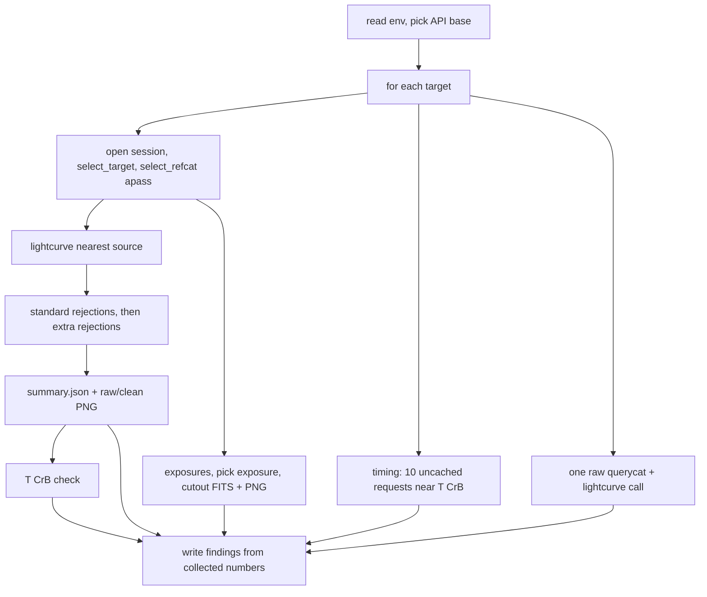

# Design: S0 Data spike

Status: **draft, awaiting review of requirements.md**.

## Layout

```
scripts/s0_spike.py                    network driver, run by hand
src/computers/data/spike.py            pure functions, unit tested
tests/unit/test_spike.py               synthetic-table tests, no network
data/spike/<target>/                   daschlab session dirs (git-ignored)
data/spike/raw/                        raw API responses, gzipped (git-ignored)
docs/decisions/assets/s0/*.png         plots and cutout images (committed, small)
docs/decisions/0001-sprint0-findings.md
```

`data/spike/` is already covered by the `data/*` ignore rule. Plots are committed because the findings record refers to them.

## Dependencies

A separate `spike` dependency group in `pyproject.toml`, so the core install stays light:

- `daschlab`, pinned to the exact version installed (record it in the findings).
- `astropy`, `matplotlib`, `numpy`, `requests`, `astroquery` (SIMBAD lookup for the quiet star).

Install check first: `daschlab` pulls in bokeh and WorldWide Telescope packages. If installation fails on Python 3.12 on the Mac, stop and report. We don't work around it silently.

## Flow



## Pure functions (`spike.py`)

Each takes plain arrays or tables so it can be tested with synthetic data.

| Function | Does | Notes |
|---|---|---|
| `summarize(table)` | Counts, date range, series counts, median detected magnitude | Uses boolean masks for detection and rejection |
| `tcrb_outburst_check(years, mags, is_detection, rejected, margin=2.0)` | R5. Returns pass/fail and the 1946 points found | Magnitudes: smaller is brighter, so "brighter by 2.0" means `baseline - mag >= 2.0` |
| `separation_report(sources, target)` | R2.2: nearest three sources with separations in arcsec | |
| `pick_quiet_star(candidates)` | Quiet-star rule below | Deterministic tie-break by catalog id |
| `cutout_offset(star_xy, shape)` | R6.5: pixel offset from the cutout centre | |
| `timing_stats(records)` | Median, max, failure count | |

Magnitudes run backwards, so the comparison direction is the easiest thing to get wrong. The tests cover it directly.

## Quiet star

Chosen from the catalog sources around T CrB so the same session serves the timing run.

1. Keep sources with APASS B between 11 and 13 (similar to the Tabby's Star brightness), at least 5 arcmin from T CrB, with detections in the top quartile of the group.
2. Look up the survivors in SIMBAD. Keep those whose object type is not a variable-star type.
3. Take the first by catalog id. Print the next two as alternates.

VSX is not available until Task 4, so SIMBAD is the proxy here. The findings record this limit.

## Rejections

1. `apply_standard_rejections()` as shipped (five AFLAGS bits).
2. Tutorial extras: `lc.reject.sep_above(15 * u.arcsec, tag="sep")`, and rejecting `AFlags.SUSPECTED_DEFECT` with `lc.reject.any_aflags(...)`.

Results are reported after step 1 alone and after steps 1 and 2, so we see what each adds. The tutorial also rejects low time accuracy for RY Cnc because its period is one day. We skip that, and note that the plan's L1 does not use short periods.

## Timing method

Open a fresh session directory for the T CrB target, then call `Session.lightcurve(i)` for `i` in 0..9, timing each call with `time.perf_counter()`. Fresh sources, so nothing is cached. Response size is measured from the saved lightcurve file, since daschlab does not expose the raw response. One extra timed call goes through `requests` directly (R8), where the raw size is known.

## Raw format capture

Direct `requests.post` against the same base URL daschlab uses, with the `x-api-key` header only when the key exists. `querycat` payload: refcat, `ra_deg`, `dec_deg`, `radius_arcsec`. `lightcurve` payload: refcat, `ref_number`, `gsc_bin_index` taken from the catalog row. Responses go to disk gzipped. The findings quote header names and one row, never the key.

## Facts established while writing this spec

From daschlab's `apiclient.py` (MIT, `main` branch, read 2026-11-23):

- The key comes from `DASCHLAB_API_KEY`. With a key, the base is `/full`. Without, `/public`.
- Responses are buffered, with a **6 MB** limit per response. Very large lightcurves could hit it. R7.3 checks how close real stars come.
- The client calls `resp.json()` and wraps any exception in one generic error. There is no retry, no rate-limit handling and no status check. The thin client in Task 4 must add all three.
- Redirects are not followed (`allow_redirects=False`).

From the RY Cnc tutorial: it runs as a Jupyter notebook on Binder with a World Wide Telescope viewer. We run the same steps as a plain script and skip the viewer.

## Risks

| Risk | Handling |
|---|---|
| `daschlab` fails to install or import on 3.12 | Stop and report. Record the error in the findings. |
| Target name doesn't resolve | Fall back to coordinates from `plan.md` 3.4 and record that. |
| T CrB 1946 points removed by standard rejections | R5.2 reports it. That is a finding, not a bug in the spike. |
| API rate limit hit without a key | Back off, record it. This is useful data for Task 4. |
| Plate scanned but no WCS solution | R6.4: record the reason. |

## Changes made while building (2026-11-23)

Found by a debug run on the public API, whose cache and plots were then deleted. None of these changes a requirement.

- **Install.** `daschlab` needs `pycairo`, which needs `pkg-config` on macOS. Fixed with `brew install pkgconf`. Cairo was already present.
- **Quiet star.** Chosen from the T CrB catalog, but fetched in its own session centred on the star, because daschlab cutouts centre on the session target.
- **Cutout offset.** The first version searched ±60 px and locked onto bright neighbours. It now searches ±24 px (about 35 arcsec) and reports the peak's significance in robust sigmas.
- **SIMBAD.** The Strasbourg server returned 404 for the whole app on 2026-11-23, so the script tries it first and falls back to `simbad.harvard.edu`, recording which one answered.
- **Timing.** Requests use catalog sources 1 to 10, since source 0 is T CrB itself. Sources already in the cache are flagged and excluded from the statistics, so a rerun without `--refresh` cannot pass off cache reads as measurements.
- **Results file.** A subset run updates only its own targets in `data/spike/results.json`.
- **Raw capture.** Also records `queryexps`, to settle the camelCase question for all three endpoints.
- **Quiet-star inputs.** `stdmag` is treated as APASS B and `num_matches` as the DASCH detection count. Both are assumptions from column names and are stated in the results.

## Not done here

No retry layer, no manifest, no Parquet. Those belong to Tasks 3 and 4. Anything written to `data/spike/` is disposable.
