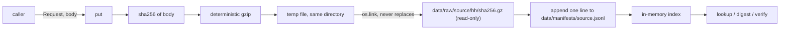

# Design: S1a Steering, hooks, schemas and snapshot store

Status: **draft, awaiting review of requirements.md**.

## Layout

```
.kiro/steering/{product,tech,structure,astro-domain,data-contracts,testing}.md
.kiro/hooks/*.json                         created with the createHook tool
scripts/hooks/block_raw_edits.py           stdlib only, so it starts fast
src/computers/data/schemas.py              eight PyArrow schemas, validate(), fingerprints
src/computers/data/snapshot.py             SnapshotStore, Request, ManifestRow
src/computers/thresholds.py                the threshold registry
src/computers/cli.py                       gains `snapshot` and `schema` subcommands
docs/schemas.lock.json, docs/schemas.md    committed, generated
docs/decisions/thresholds.lock.json        committed
docs/decisions/0002-initial-thresholds.md
tests/unit/test_{schemas,snapshot,thresholds,layer_rules,block_raw_hook}.py
tests/property/test_snapshot_props.py
```

New core dependencies: `pyarrow` (schemas, later Parquet) and `requests` (the probe, later the thin client). DuckDB waits until a task queries tables.

## Schemas

PyArrow schemas are the single source of truth, because they are the objects used to write Parquet. Version 1 for every table. Column names follow daschlab's names (Sprint 0 W2). Types below use `u` for unsigned, `f` for float, and `?` for nullable.

| Table | Primary key | Columns |
|---|---|---|
| `stars` | `ref_number` | `ref_number` u64, `refcat` str, `ref_text` str, `gsc_bin_index` u32, `ra_deg` f64, `dec_deg` f64, `pm_ra_masyr` f32?, `pm_dec_masyr` f32?, `apass_b` f32?, `color` f32?, `num_matches` u32, `tile` str, `n_points` u32? |
| `measurements` | `ref_number`, `exposure_id` | `ref_number` u64, `exposure_id` str, `time` f64 (HJD), `magcal_magdep` f32?, `magcal_local_rms` f32?, `limiting_mag_local` f32, `series` str, `platenum` u32, `mosnum` u32?, `solnum` u32?, `expnum` i32?, `aflags` u32?, `a2flags` u32?, `bflags` u32?, `b2flags` u32?, `local_bin_reject_flag` u32?, `fwhm_image` f32?, `ellipticity` f32?, `plate_dist` f32?, `blended_mag` f32?, `ra_deg` f64?, `dec_deg` f64?, `image_x` f32?, `image_y` f32?, `time_accuracy` f32?, `drad_rms2` f32?, `extinction` f32?, `reject` u64 |
| `exposures` | `exposure_id` | `exposure_id` str, `series` str, `series_kind` str?, `platenum` u32, `mosnum` u32?, `solnum` u32?, `expnum` i32?, `plate_class` str?, `exptime` f32?, `obs_date` timestamp[us, UTC]?, `wcssource` str?, `has_imaging` bool, `lim_mag_apass` f32?, `median_colorterm_apass` f32?, `center_distance` f32?, `edge_distance` f32?, `ra_deg` f64?, `dec_deg` f64? |
| `cutouts` | `cutout_id` | `cutout_id` str, `ref_number` u64, `exposure_id` str, `path` str, `ra_deg` f64, `dec_deg` f64, `offset_dx` f32?, `offset_dy` f32?, `offset_sigma` f32?, `classifier_a_score` f32?, `classifier_version` str? |
| `candidates` | `candidate_id` | `candidate_id` str, `ref_number` u64, `tile` str, `event_type` str, `epoch_start` f64, `epoch_end` f64, `amplitude_mag` f32, `single_plate` bool, `l1_flags` list<str>, `l2_score` f32?, `snapshot_digest` str, `code_version` str |
| `verdicts` | `verdict_id` | `verdict_id` str, `candidate_id` str, `verdict` str, `cause` str, `confidence` f32, `evidence_ids` list<str>, `rationale` str, `model_id` str, `prompt_hash` str, `tokens_in` i64?, `tokens_out` i64?, `cost_usd` f64?, `created_at` timestamp[us, UTC] |
| `labels` | `label_id` | `label_id` str, `target_type` str, `target_id` str, `label` str, `defect_type` str?, `labeller` str, `labelled_at` timestamp[us, UTC], `note` str? |
| `telemetry` | `run_id`, `ref_number` | `run_id` str, `ref_number` u64, `stop_layer` str, `reason` str, `wall_seconds` f32, `tokens` i64?, `cost_usd` f64? |

Notes:

- The `reject` bit names are not fixed here. daschlab assigns tag bits in the order tags are first used, so we cannot reuse its numbers. Task 6 defines our own fixed bit registry.
- Enumerated strings (`event_type`, `verdict`, `cause`, `target_type`) stay plain strings here. Appendix B's Pydantic models define the allowed values when the crew exists.
- Every column's definition can change later, but only by raising that table's version and regenerating the lock.

**Fingerprint.** `sha256` of canonical JSON of `{name, version, primary_key, fields: [[name, type string, nullable], ...]}`, with the field order kept (it is the Parquet column order).

**`validate(name, table)`.** Checks, in order: same column set, each column's exact type, then null counts for non-nullable columns. Raises `SchemaError` naming the table, the column and the problem. It does not coerce.

**Lock and docs.** `computers schema lock` writes `docs/schemas.lock.json` (`{table: {version, fingerprint}}`). `computers schema docs` writes `docs/schemas.md`. Tests compare both with freshly generated content. The two-step rule (R3.3) falls out naturally: changing a field changes the fingerprint, bumping the version alone changes nothing the lock records, so the lock must be regenerated either way.

## Snapshot store



**Request.** `source` (such as `dasch-dr7`), `method`, `endpoint`, `body` (JSON-able dict or `None`), `api_base` (`public` or `full`). No headers field exists. The constructor rejects a body with a key whose name suggests a credential (`key`, `token`, `secret`, `authorization`, `password`, case-insensitive). `api_base` is recorded but excluded from the request key, since both bases return the same data.

**Request key.** `sha256("{method} {endpoint} " + canonical_json(body))`, with `canonical_json` using sorted keys and compact separators.

**Manifest row** (one JSON object per line, keys in a fixed order):

| Field | Meaning |
|---|---|
| `sha256` | Hash of the uncompressed response body |
| `source`, `method`, `endpoint` | What was asked, and of whom |
| `request` | Canonical JSON string of the body |
| `request_key` | As above |
| `path` | Raw file path relative to `data/raw/` |
| `bytes` | Uncompressed size |
| `fetched_at` | UTC, `YYYY-MM-DDTHH:MM:SS.ffffffZ` |
| `client_version` | For example `computers/0.1.0 requests/2.34.2` |
| `api_base` | `public` or `full` |

**Writing a raw file.** Compress with `gzip.compress(body, mtime=0)`. Write to a temporary file in the destination directory, flush and `fsync`. Then `os.link(tmp, final)`, which fails if `final` exists and so never replaces it. On `FileExistsError`, decompress and hash the existing file: equal means a harmless repeat, unequal raises `ImmutableError`. Remove the temp file, then `chmod 0o444`. A crash leaves at most a stray temp file named `.tmp-*`, never a file whose content doesn't match its name (R7.2). `verify` reports stray temp files.

**Appending a row.** Open the manifest with `O_APPEND`, take `flock(LOCK_EX)`, write the whole line in one `os.write`, `fsync`, release. A threading lock in front of it keeps threads from queueing on the file lock. The raw file is written before the row, so a row never points at a missing file; a crash between the two leaves a raw file with no row, which `verify` lists as unreferenced and a repeat `put` repairs.

**Torn lines.** Readers skip any line that is not valid JSON, and `verify` reports each one as an error. Before appending, `put` checks that the file ends in a newline and adds one if not, so a damaged tail cannot merge with a new row. No existing row is ever rewritten.

**Lookup, digest, verify.** An in-memory index (per manifest, rebuilt when the file size or mtime changes) maps `request_key` to its rows in file order. `lookup` returns the last row whose raw file exists. `digest` sorts `source\trequest_key\tsha256` for the newest row per key and hashes the joined lines. `verify` hashes every referenced file and walks `data/raw/` for files no row mentions.

**What the store does not do.** Retries, rate limiting, pagination and parsing belong to Task 4. It stores whatever bytes a caller hands it from a successful response, and refuses anything with a non-2xx status.

## CLI

`computers snapshot probe | verify | digest | status [--data-dir DIR]` and `computers schema lock | docs | check`. The data directory defaults to `./data`. The probe calls `GET https://api.starglass.cfa.harvard.edu/public/health` with a 20 second timeout, hands the response to `put`, and prints the row. It exits non-zero with no row on any failure. The existing `argparse` parser in `cli.py` gets subparsers.

## Thresholds

```python
@dataclass(frozen=True)
class Threshold:
    name: str; value: float; unit: str; status: str  # "start" | "decided"
    plan: str                                         # e.g. "3.2"
```

`THRESHOLDS: dict[str, Threshold]`. The lock `docs/decisions/thresholds.lock.json` maps each name to `{value, decision}`, where `decision` is a path under `docs/decisions/`. The test fails when a value differs from the lock, when the lock names a file that doesn't exist, and when a threshold has no lock entry. To change a value: write a new decision file, update the lock entry to point to it, and change the value. Seeds: `amplitude_floor_long_term_mag` 0.5, `amplitude_floor_single_epoch_mag` 1.0, `astrometry_max_sep_arcsec` 15, `source_split_radius_arcsec` 5, all `start`, all pointing at `0002-initial-thresholds.md`.

## Layer rules

An AST walk (no imports executed) over each package. Banned imports below L3: `nooa`, `litellm`, `openai`, `anthropic`. Banned inside `l1/`: any import from `computers.l2` or `computers.crew`. Packages that do not exist yet are skipped, so the test costs nothing now and bites later.

## Hooks

| File | Trigger | Matcher | Action |
|---|---|---|---|
| `block-raw-edits` | `PreToolUse` | `fs_write\|str_replace\|fs_append\|delete_file\|smart_relocate\|semantic_rename` | command: `python3 scripts/hooks/block_raw_edits.py` |
| `props-on-numeric-change` | `PostFileSave` | `src/computers/(l1\|bench)/.*\.py$` | agent: run `uv run pytest tests/property -q` and report failures |
| `schemas-on-change` | `PostFileSave` | `src/computers/data/schemas\.py$\|\.kiro/steering/data-contracts\.md$` | agent: run `uv run pytest tests/unit/test_schemas.py -q`; if the lock is stale, say which table and that it needs a version bump and `computers schema lock` |
| `thresholds-on-change` | `PostFileSave` | `src/computers/thresholds\.py$` | agent: run `uv run pytest tests/unit/test_thresholds.py -q`; remind that a changed value needs a new decision file |

**The blocking script.** Reads the hook's JSON from stdin. Walks `tool_input` for string values under the keys `path`, `targetFile`, `sourcePath`, `destinationPath`, `file`, `filePath`. Resolves each against the workspace root and exits 2 with a one-line message when one lies inside `<workspace>/data/raw/`. Content such as "data/raw/" inside a document body is never examined. When the input is unreadable it exits 0, so a hook bug never blocks unrelated work.

**Unknown: the real hook input.** The hook input format is not documented in what I could read. So the first hook task logs one real `PreToolUse` event, and the script's key names are checked against it before the hook is relied on. This is the main risk in this spec.

**Known gap.** The hook guards the agent's file tools. A shell command that writes into `data/raw/` is not blocked. The store's own no-overwrite and read-only rules cover the bulk of the risk, and `verify` catches changes after the fact.

## Enforcement summary

| Rule | Enforced by | Also nudged by |
|---|---|---|
| Schema change needs a version bump and lock | `test_schemas.py`, pre-commit | `schemas-on-change` hook |
| Threshold change needs a decision record | `test_thresholds.py`, pre-commit | `thresholds-on-change` hook |
| No LLM client below L3 | `test_layer_rules.py`, pre-commit | steering `tech.md` |
| Raw data never edited | store (no overwrite, read-only), `verify` | `block-raw-edits` hook |
| Numeric code stays correct | property tests, pre-commit | `props-on-numeric-change` hook |

## Steering files

| File | Inclusion (pending question 1) | Main content |
|---|---|---|
| `product.md` | always | What and what not (1.1, 1.2), claims policy (11.5), "vanished" never in a headline |
| `tech.md` | always | Stack, commands, the rules in R1.3, secrets |
| `structure.md` | always | Layout (4.3), layer contracts (4.2) |
| `astro-domain.md` | `fileMatch` on `src/computers/{data,l1,l2,bench}/**` | Magnitudes, known issues (3.3), floors (3.2), Sprint 0 findings that bind L1 |
| `data-contracts.md` | `fileMatch` on `src/computers/data/**`, `data/**`, `docs/schemas*` | Tables, manifest rule, raw immutability, naming, version rule |
| `testing.md` | `fileMatch` on `tests/**`, `src/computers/{l1,l2,bench}/**` | Test kinds, tile splits, benchmark delta, decision records |

Each file is written from the plan sections and findings it names, kept short, and checked against the secret scanner (R1.8).

## Changes made while building (2026-11-24)

None changes the intent of a requirement.

- **Repeat puts (R4.4).** The store compares against the *newest* row for a request, not any earlier row. A response that flips A, B, A therefore appends a third row, so `lookup` returns the current answer.
- **`lookup` signature.** `lookup(request)`, since `Request` already carries the source and endpoint.
- **Stronger version-bump check.** `schemas.bump_violations` and `computers schema check` compare against git HEAD's lock, because a regenerated lock alone would hide a missing bump. The lock stores a version-free `structure` fingerprint for this. It starts to bite at the first commit. `thresholds.change_violations` and `computers thresholds check` do the same for decision files.
- **Both checks run in pre-commit** next to the fast tests.
- **Hook payload format (R12.2).** A live capture was not possible: Kiro loads new hooks at the next session start. The script follows the format other people measured on live Kiro IDE builds (AWS Labs, "Kiro IDE hook payload, empirical reference"): JSON on stdin with `tool_name` and `tool_input` (older builds `toolName` and `toolArgs`), an `fs_write` input of `{path, text}`, and a block by exit 2 with the reason on stderr. The script accepts both naming styles, lets a call through when the input is empty, and does not wait for stdin to close. **Still to confirm live in the next session** (see tasks.md step 8).
- **Diagnostic log.** The hook appends one line to `data/hooks/block_raw_edits.log` (git-ignored) only when it blocks a call or cannot read the input, never with file contents. That is how the real payload shape will be confirmed.
- **Steering syntax.** Checked against Kiro's docs: `fileMatchPattern` accepts an array.

## Risks

| Risk | Handling |
|---|---|
| Hook input format differs from my guess | Capture one live event first (tasks.md step 8) |
| `os.link` unsupported on the filesystem | The Mac's APFS supports it. A fallback to `O_EXCL` creation is added only if a test shows a problem |
| Pre-commit becomes slow as tests grow | `-x -q` now (about 1 second). Revisit when the fast suite passes 10 seconds |
| Schema changes pile up in later sprints | Intended: each one is a visible version bump with a lock diff |
