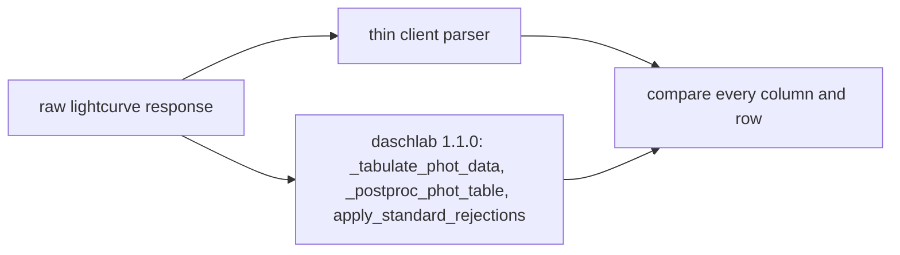

# Design: S1b Thin client, golden test and tile pilot

Status: **draft, awaiting review of requirements.md**.

## Layout

```
src/computers/data/tiles.py          tile geometry, query boxes, membership
src/computers/data/dasch_client.py   transport, retries, resume, concurrency
src/computers/data/dasch_parse.py    raw responses to our tables, standard rejections
src/computers/data/silver.py         atomic Parquet writes with metadata
src/computers/data/pull.py           stages, pilot subset, report
src/computers/data/plates.py         plate-overlap between tiles
src/computers/cli.py                 gains `pull` and `plates`
scripts/s1_access_checks.py          VSX, SIMBAD, ZTF, Gaia, DR4
docs/outreach/dasch-email-draft.md
docs/decisions/0003-tile-sizes-and-access.md   written after the run
tests/unit/test_{tiles,dasch_client,dasch_parse,silver,pull,plates}.py
tests/golden/test_lightcurve_parity.py         offline, against daschlab
tests/golden/fixtures/                          excerpts (pending question 1)
tests/network/test_parity_live.py              marked `network`
```

No new dependencies. `daschlab` stays in the `spike` group and is imported only by scripts and tests.

## Facts behind the design

| Fact | How it was found |
|---|---|
| The query box is a true on-sky square. Max `dra_asec` was 849.9 for radius 850, while the RA span was 944.5 arcsec of RA, which is 849.5 on sky at dec +25.9 | Raw `querycat` response for T CrB (Sprint 0) |
| Query time grows with box area, not star count: 1,800 arcsec took 17 s (1,473 sources) and 19 s (11,594 sources) | Sprint 0 probes |
| T CrB and Tabby share 2,363 plates (14.6% and 12.5%). M44 shares 1 plate with each | `exposures.ecsv` from the three Sprint 0 sessions, one position per field |
| `stdmag` is Johnson B for APASS. `num_matches` is the DASCH detection count. `v_flag` is an ad hoc "uncertain magnitude" flag | DASCH catalog-columns page |
| The point flag `UNCERTAIN_CATALOG_MAG` equals the catalog `v_flag` for all four Sprint 0 stars. 97% of the T CrB field's sources have `v_flag=1` | `refcat.ecsv` of the four sessions |
| Gaia ESA archive is down from 2026-11-25 12:00 CET. DR4 is released 2026-12-02 12:00 CET | ESA archive banner, read 2026-11-24 |
| Gaia DR3 is served by `vizier.cfa.harvard.edu` (`I/355/gaiadr3`). The Strasbourg VizieR failed on 2026-11-23 | Probe |
| ZTF's HTTP API returned no rows for B=11.0 and 759 rows (zg, zi; 2018 to 2026; mag 11.9 to 14.3) for B=13.2 | Probe |
| `center_distance` and `edge_distance` in the exposures table are in **cm** (on the plate), not degrees | daschlab source |

## Tiles (`tiles.py`)

```python
@dataclass(frozen=True)
class Tile: name: str; ra0: float; dec0: float   # degrees, tile centre
def catalog_boxes(tile) -> list[Box]       # 4 boxes: centre, radius 1850 arcsec
def exposure_positions(tile) -> list[(ra, dec)]   # centre + 4 corners
def in_tile(tile, ra, dec) -> bool         # |dec-dec0| <= 1 and |ra-ra0|*cos(dec0) <= 1
```

Box centres: `dec_box = dec0 +/- 0.5`; `ra_box = ra0 +/- 0.5 / cos(dec_box)`. Radius 1,850 instead of 1,800 so adjacent boxes overlap by 50 arcsec, which also covers the small change of `cos(dec)` across a box (about 31 arcsec at Tabby's declination). Duplicates are removed by `ref_number`, and sources outside the tile are dropped.

Tile centres are in the plan (M44) and Sprint 0 (the other two). The M44 centre is approximate (130.1, +19.7), as the plan says. It is a convention, not a measurement.

## Client (`dasch_client.py`)

```python
class Transport(Protocol):
    def request(self, method, url, json, headers, timeout) -> Response   # status, content, headers
class RequestsTransport: ...          # the only code that imports `requests` here
class DaschClient:
    def __init__(self, store, transport=None, env=os.environ, policy=RetryPolicy(), clock/sleep injectable)
    def querycat(self, ra, dec, radius_arcsec, refcat="apass") -> list[str]
    def queryexps(self, ra, dec, midpoint_min=None, midpoint_max=None) -> list[str]
    def lightcurve(self, refcat, ref_number, gsc_bin_index) -> list[str]
```

Each method builds a `Request` (source `dasch-dr7`, endpoint `/dasch/dr7/<name>`, body as in daschlab's client), then:

1. `store.lookup(request)`. If found, read it back and return. No network.
2. Otherwise send it, with the policy below.
3. Check the response is a JSON list of strings whose first record names the columns the parser needs. A mismatch raises `FormatError` and stores nothing.
4. `store.put(request, body)`, then return the parsed records.

**Base and key.** The base is `.../full` when `STARGLASS_API_KEY` is set, otherwise `.../public`. The key goes in an `x-api-key` header built inside the transport call and never stored anywhere else. Any exception text goes through `redact(text, key)`.

**Retry policy.** `max_attempts=5`, delay `min(60, 2 * 2**attempt)` seconds with up to 25% jitter, or the server's `Retry-After` when larger. Retry on HTTP 429, 500, 502, 503, 504, on timeouts and on connection errors. Do not retry other 4xx (a 400 means our request is wrong). Timeouts: 10 s to connect, 60 s to read, because a 504 arrives at about 30 s.

**Concurrency.** A `ThreadPoolExecutor` for lightcurves, default 3, range 1 to 4. A shared limiter keeps request starts at least 0.2 s apart. On an HTTP 429 the pool shrinks by one worker and the event is counted. The rate limits are not documented, so these are starting values.

**Errors do not stop a pull.** Each task returns a result or a recorded failure. The pull finishes everything else, then exits non-zero if any failure remains.

## Parsing (`dasch_parse.py`)

`parse_records(lines)` turns the list of CSV strings into `{name: [str]}` with a check that every row has as many fields as the header. Then one function per table.

**Raw name to our name, `measurements`** (types are Arrow; "null if" lists every rule):

| Ours | Raw | Type | Null when |
|---|---|---|---|
| `time` | `date_jd` | float64 | never |
| `magcal_magdep` | `magcal_magdep` | float32 | non-detection or NaN |
| `magcal_local_rms` | `magcal_local_rms` | float32 | non-detection, NaN or 99 |
| `limiting_mag_local` | `limiting_mag_local` | float32 | never |
| `series` | `series` | string | never |
| `platenum` | `plate_number` | uint32 | never |
| `mosnum`, `solnum` | `mosaic_number`, `solution_number` | uint32 | never |
| `expnum` | `exposure_number` | int32 | never |
| `aflags`, `a2flags`, `bflags`, `b2flags` | same | uint32 | non-detection |
| `local_bin_reject_flag` | `reject_flag` | uint32 | non-detection |
| `fwhm_image` | `fwhm_pix` | float32 | non-detection or NaN |
| `ellipticity` | `ellipticity` | float32 | non-detection or NaN |
| `plate_dist` | `plate_center_dist_deg` | float32 | non-detection or NaN |
| `blended_mag` | `blended_mag` | float32 | non-detection, NaN, 0 or 99 |
| `ra_deg`, `dec_deg` | same | float64 | non-detection or NaN |
| `image_x`, `image_y` | `x_image`, `y_image` | float32 | non-detection or NaN |
| `time_accuracy` | `time_accuracy_days` | float32 | non-detection or NaN |
| `drad_rms2` | `drad_rms2` | float32 | non-detection, NaN or 99 |
| `extinction` | `extinction` | float32 | non-detection or NaN |
| `ref_number` | from the request | uint64 | never |
| `exposure_id` | built from `series`, `plate_number`, `mosaic_number`, `solution_number` | string | never |
| `reject` | constant 0 | uint64 | never |

A **non-detection** is a row with `gsc_bin_index == 0` and `sextractor_number == 0` (daschlab's own rule). Empty fields read as NaN, as in daschlab's `maybe_float`, and NaN becomes null in Arrow. Float32 columns convert from the text with `np.float32`, so values match daschlab bit for bit.

**Standard rejections.** `STANDARD_BAD_AFLAGS = (1<<6) | (1<<11) | (1<<12) | (1<<13) | (1<<15)`, the values of `HIGH_BACKGROUND`, `LARGE_ISO_RMS`, `LARGE_LOCAL_SMOOTH_RMS`, `CLOSE_TO_LIMITING` and `BIN_DRAD_UNKNOWN` in daschlab 1.1.0. A test asserts those constants against daschlab's enum. `apply_standard_rejections(table)` returns a new table with `reject |= 1` on matching rows. Our own named bit registry arrives in Task 6, and bit 0 stays "standard aflags".

**Catalog and exposures.** `parse_catalog` gives all sources with their offsets. `stars_from_catalog` applies tile clipping, the brightness cut and the column renames in R2.2. `parse_exposures` follows R4.6, with timestamps parsed from `expdate` as UTC and unreadable or empty ones left null, and `series_kind` left null.

## Silver files (`silver.py`)

`write_table(table_name, table, path, snapshot_digest)`: validate, write with zstd to `<path>.tmp`, `os.replace`. Metadata keys `computers.snapshot_digest`, `computers.schema_version` and `computers.written_by` (version string). `measurements` for a tile is one file, built after all lightcurves are in.

## Pull (`pull.py`)

```
catalog:     4 querycat calls  ->  dedupe  ->  clip to tile  ->  stars (B <= 13.5)  ->  silver/stars
exposures:   5 queryexps calls ->  dedupe  ->  silver/exposures
lightcurves: pilot subset -> N lightcurve calls (3 workers) -> parse -> silver/measurements
report:      data/reports/pull-<tile>-<utc>.json
```

Stages can run alone (`--stage`). The lightcurve stage reads the `stars` table, so the catalog stage must have run. The pilot subset, when needed, is stratified by 0.5 mag bin with `numpy.random.default_rng(20261124)`, taking the same share from each bin and rounding up so no bin is empty.

**Resume** is the store's: a repeated request is found and skipped. A killed run leaves complete raw files and manifest rows, because the store writes the file before the row, so nothing needs repair. The Parquet files are written last, from the stored responses.

**Report.** Counts per magnitude bin, request counts (made, from store, failed), retries by status, concurrency used and whether it was lowered, median and p95 seconds per endpoint (made requests only), bytes, the snapshot digest, and the failure list.

## Plate overlap (`plates.py`)

Reads `silver/exposures/tile=*.parquet`. A plate is `series + platenum` (zero-padded to 5), so different exposures of one plate count once. For each pair of tiles: shared plates, share of each tile's plates, and the shared plates grouped by series. Output is a plain text table. It also prints the five-position exposure count per tile so a reader sees how much of the sky was sampled.

## Golden test (`tests/golden/test_lightcurve_parity.py`)



The comparison converts daschlab's masked columns to plain arrays with a missing mask. Equal means: same length, same dtype width, identical values where both are present, and both missing in the same rows. It also compares `(reject != 0)` row by row. It uses daschlab's private parsing functions, which is acceptable because the version is pinned and the test fails loudly if they change.

Inputs are the 20 or more raw lightcurve responses in the local snapshot after the pilot (the test skips when fewer than 20 are present and says why), plus the committed excerpts if question 1 allows them. The same test also runs on synthetic rows that cover every sentinel and every non-detection rule, so it exercises edge cases the real data may lack.

The live test (`tests/network/`) pulls the same 20 stars through daschlab's own client into a temporary session and through the thin client into a temporary store, then runs the same comparison. It checks that our requests return what daschlab's do.

## Access checks (`scripts/s1_access_checks.py`)

For each check: what was asked, the server, the elapsed time, `ok`, a short result and an error string when it failed. Checks: VizieR `B/vsx/vsx` for T CrB, RY Cnc and KIC 8462852 on both servers; SIMBAD on both servers; ZTF for the T CrB-field star at B 13.17 (`APASS_J155934.2+254417`); Gaia DR3 through the ESA archive (expected to fail after 25 November) and through VizieR; a DR4 schema listing on the ESA archive. Output goes to `data/spike/access-checks.json` and to the decision record. Safe to rerun after 2 December.

## DASCH email

Covers Appendix D, with these points added from the findings:

- Planned load, with the measured numbers from the pilot.
- The documented 3,600 arcsec `querycat` limit that the API rejects, and the 504 at 3,000 arcsec and above.
- The 6 MB response limit and how close `queryexps` comes to it.
- What the exposure `class` values mean, and how complete they are.
- Whether the per-point `UNCERTAIN_CATALOG_MAG` bit is the catalog `v_flag`.
- The undocumented `reject_flag` and `pass_bits` columns.
- Acceptable request rates for the full API, and whether a bulk export of three tiles is easier.
- Whether small excerpts and derived cutout sets may be published, and under what terms.
- An offer to share the defect-labelled set and the benchmark back.

## Changes made while building (2026-11-24 to 25)

Found by running the code against real responses. None weakens a requirement. Each is covered by a test.

| Change | Why |
|---|---|
| `exposure_id` is `{series}{platenum:05d}e{expnum}` plus `s{solnum}` when there is a solution, in both `measurements` and `exposures` | daschlab's `m{mosnum}s{solnum}` form fails twice on T CrB's field: 30 duplicate ids (scanned plates with no solution all get `s-1`), and **506 of 2,605 detections (19%)** name a mosaic the exposure list does not have, because the plate was re-scanned (`m0` in the lightcurve, `m1` in `queryexps`). The new form is unique for all 16,326 exposures and joins all 2,882 lightcurve rows, non-detections included. Joining by mosaic number matches only 80.6% of detections. |
| Lightcurve rows are sorted by time and then by a fixed key | The API returns rows with equal timestamps in a different order on every call (67 of 4,740 positions differed between two fetches of one star). Without a fixed key the silver table would depend on which fetch happened to be stored. Consequence for the snapshot store: **re-fetching the same request can give different bytes**, hence a new manifest row and a different digest, even though the content is the same. Re-fetches are rare, since requests are resumed from the store, but a future "has the data changed?" check must compare responses as multisets of rows. |
| `expdate` accepts three forms and a seconds value of 60 | Real data has `...:30.2Z`, `...:13.8` (no Z) and `...T03:30` (minute only), and two values like `05:07:60.0`. Astropy reads 60 s as a leap second; we add the time of day to the date as a duration. |
| Empty `exposure_number` reads as 0 | Non-detections have none, and daschlab turns an empty integer into 0. Kept for parity. |
| `limiting_mag_local` and `date_jd` are required | daschlab raises on an empty value there. We raise too, instead of writing a null that would fail schema validation later. |
| The pull waits for in-flight requests when interrupted | A worker thread caught between "raw file written" and "manifest row appended" left an unreferenced file. Harmless, and repaired by a repeat run, but the store should be tidy when control returns. |
| Live parity compares the raw responses of daschlab's `ApiClient` and ours, as multisets | Cheaper than daschlab's sessions, which make an 18 s `queryexps` call per star, and it tests exactly what matters: that our requests return what daschlab's do. The test lives in `tests/golden/test_live_parity.py`, not `tests/network/`. |
| `center_distance`, `edge_distance` and `lim_mag_apass` are null in the tile `exposures` table | `queryexps` reports them relative to the queried position. Copies of one exposure from the five positions differ only in these three columns (17,254 of 17,849 exposures near T CrB were seen from several positions, and every difference was in them), so a merged table would hold whichever position answered first. The report counts these as `copies_differing_only_in_query_relative_columns` and keeps `conflicting_duplicates` for real disagreements (zero in the real data). The per-detection `plate_dist` and `limiting_mag_local` in `measurements` are the right values. `median_colorterm_apass` does not vary with position and is kept. |
| Plate class is **not** pulled | `queryexps` leaves `class` empty for every exposure (about 49,000 in the three fields). The batch `GET /plates?ids=` endpoint gives a class for 93% of a 300-plate sample, 100 plates per call, but DASCH's Colorterms page recommends the pipeline colourterm over plate class, and `exposures.median_colorterm_apass` is already in our table. So no extra stage: the emulsion check (Sprint 3) uses the colourterm, with plate class as a secondary hint. |
| Units: `center_distance` and `edge_distance` are in **cm** on the plate | Read from daschlab's source. Now stated in the schema docs. |

## Risks

| Risk | Handling |
|---|---|
| The golden test finds differences | Fix the parser, or stay on daschlab (R5.5) and record why |
| The full API rate limit is lower than assumed | Concurrency drops on 429, and the report says so; ask the DASCH list |
| The pilot takes longer than 25 minutes | It resumes. A 500-star slice is enough to test the client, the rest can run later |
| `queryexps` exceeds 6 MB in a denser field | Split by date range (R6.2), tested with a stub |
| The tile-centre convention for M44 is off | It only moves the box; the pull reports how many sources fall outside |
| Gaia DR4 tables differ from DR3 | The access check records what exists. DR3 stays the fallback until the layout is read |
