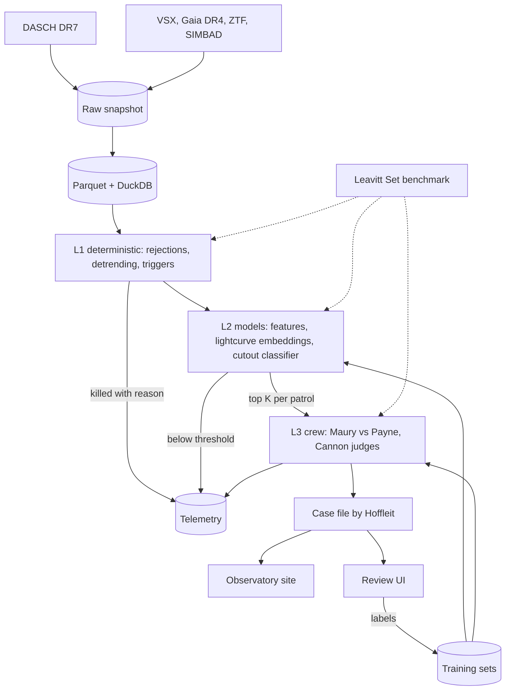

# The Computers -- Build Plan

**One line:** a crew of agents, named after the women of the Harvard Observatory, that patrols a century of digitized glass plates for stars that faded or flared -- and can prove how reliable it is.

---

## Changelog

### 2026-11-23 -- review pass (Task 1)

Findings from checking the plan against primary docs and from a design review. Each change is also marked in place with **[rev 2026-11-23]**.

**Decisions made**
- Repo is public, licensed **AGPL-3.0-or-later**. Data storage is committed manifests plus `aws s3 sync`, no DVC (sections 4.4, 16).
- Thin client first for bulk pulls, tested against a pinned daschlab (5.3).
- Work proceeds one sprint at a time. Each sprint starts as a Kiro spec, and execution stops after each sprint for review.

**Verified facts folded in**
- `querycat` is a box search up to 3,600 arcsec, so one call covers a 2 degree tile. Raw API rows are CSV strings in JSON with camelCase column names. daschlab adds `reject`, `local_id`, `exp_local_id`, `plate_local_id` itself (5.1, 5.3).
- `apply_standard_rejections()` is readable in the MIT-licensed daschlab source. It only rejects five AFLAGS bits and warns it will change, so pin the version (6.1).
- NOOA's default strategy is `CodeActStrategy`, which executes generated code. Every ellipsis method needs `@strategy(PredictStrategy())`, enforced by a test. NOOA tracing silently turns off when no viewer runs, so cost telemetry comes from our own LLM wrapper (8.2, 8.6).
- DASCH's plate-class data is incomplete. The emulsion check needs an "unknown" state (6.1). Cutouts can be off-centre by hundreds of pixels (9.2).
- ZTF has an IRSA HTTP lightcurve API (use the HATS route above about 1,000 lightcurves). Gaia DR4 table names are confirmed (3.5).
- DASCH's citation page says no paper describes DR7 yet. The DR7 overview arXiv id listed in section 17 is **unconfirmed**.

**Design changes**
- Tiles probably hold far fewer stars than first assumed (5.4). Sprint 1 measures the real count and sets the case-count targets.
- Splits are by tile for lightcurve data. All stars in a tile share nearly the same plates, so a split by star does not separate plates (9.0).
- Detrending comparison stars are matched on colour as well as brightness (6.2).
- E1 samples observations evenly across the century. The tile and series nuisance probe is replaced by a timestamp-shuffle test (9.1, 9.5).
- Every LLM response is cached by model, provider and prompt hash, with OpenRouter providers pinned (8.6).
- The D2 student is chosen with activation-cache memory in mind (9.5).

**Still unconfirmed**
- Gaia DR4 release date of 2 December 2026 (3.5). Check in Sprint 1.
- ~~VSX access through VizieR (5.1).~~ Confirmed 2026-11-23 on the CfA mirror (see the Sprint 0 entry below).

### 2026-11-24 -- Sprint 0 data spike

Full record: `docs/decisions/0001-sprint0-findings.md`. Exit test passed: the 1946 T CrB eruption is visible, the L1 columns are listed, and request times are measured (median 2.2 s per lightcurve).

- **querycat radius.** The documented 3,600 arcsec maximum is rejected, and 3,000 and above time out. A tile is four calls of 1,800 arcsec (3.4, 5.1, 5.2).
- **Raw column names.** `querycat` and `lightcurve` are snake_case. Only `queryexps` is camelCase. All differ from daschlab's table names (4.5).
- **`plate_quality_flag` does not exist.** Removed from `measurements` (4.5).
- **Standard rejections remove most of the T CrB eruption** (25 of 32 points) and 30 to 44% of detections overall. L1 keeps those points visible to the outburst trigger (6.1 step 2).
- **Tabby's Star drifts 0.18 mag fainter over the century** with no detrending, and the quiet star does not. This is the test case for ensemble detrending (6.2, Sprint 3).
- **`UNCERTAIN_CATALOG_MAG` is not a variability flag.** Set on the quiet star, not on Tabby's Star.
- **VSX works** through `astroquery.vizier` on the CfA mirror. The Strasbourg SIMBAD and VizieR servers were down on 2026-11-23, so catalog clients take a list of servers.
- **Tile sizes.** Early estimate from one 0.22 square degree box per target: about 735 stars brighter than B 13.5 for M44, 180 for T CrB, 1,040 for the Tabby tile.
- **RY Cnc is inside the M44 tile** (3.4).

### 2026-11-24 -- Sprint 1a foundations

Spec: `.kiro/specs/s1a-foundations/`. Six steering files, eight table schemas with a version lock, the snapshot store with committed manifests, a thresholds registry, layer-rule tests, four hooks, and pre-commit running the fast tests.

- **Enforcement is by tests and pre-commit,** not by save hooks (12.4).
- **The first probe command is `computers snapshot probe`,** not `pull --dry-run`. `pull` arrives with the thin client in Sprint 1b.
- **Schema and threshold changes are checked against git HEAD** as well as the lock, so regenerating a lock cannot hide a missing version bump or decision record.
- **Open:** confirm through Kiro itself, in the next session, that the `block-raw-edits` hook refuses a write under `data/raw/`.

### 2026-11-25 -- Sprint 1b thin client

Spec: `.kiro/specs/s1b-thin-client/`. Record: `docs/decisions/0003-tile-sizes-and-access.md`. The thin client reproduces daschlab 1.1.0 exactly on all 30 real stars of the golden set, and the pilot ran on the full API for all three tiles.

- **Measured tile sizes** (stars with B at most 13.5): M44 444, T CrB 186, Tabby 1,058, total 1,688. The estimate in 5.4 was too high, as suspected. The whole tile is the pilot, and the lightcurve pull takes about 5 minutes.
- **Catalog tile = four `querycat` boxes of radius 1,850 arcsec.** Catalog sources per tile: 7,466 / 6,275 / 47,495. Exposures per tile: 15,146 / 17,849 / 21,384.
- **Emulsion check uses `median_colorterm_apass`,** not plate class (the class field is empty in the API). Below -1.13 is red, above -0.53 is blue, otherwise yellow, and exactly 0.0 is suspect. There is no plate-class pull stage.
- **`exposure_id` is `{series}{platenum:05d}e{expnum}`, plus `s{solnum}`** when there is a solution. daschlab's `m{mosnum}s{solnum}` form duplicates ids, and 19% of T CrB detections reference a stale mosaic.
- **Lightcurve rows are sorted by a fixed key,** because the API's order among ties is nondeterministic. The query-relative exposure columns (`center_distance`, `edge_distance`, `lim_mag_apass`) are nulled in tile exposure tables.
- **Public API limit is about 1.2 requests per second** and returns HTTP 429 above that. The full API took 4.5 requests per second at concurrency 3 with no 429s.
- **Plate overlap between tiles:** T CrB and Tabby share 3,381 plates, M44 shares about none. The shared plates carry 5.5% (T CrB) and 1.2% (Tabby) of the stars' measurements.
- **Defaults adopted** (`0004`): the absolute L3 budget cap (7.5) and the plate-disjoint split rule (9.0). You can overrule either.
- **Outside services on 2026-11-25:** Strasbourg VizieR and SIMBAD were down (SIMBAD works on `simbad.harvard.edu`). The CfA VizieR mirror is flaky for VSX. AAVSO's API sits behind Cloudflare. Gaia DR4 is due 2026-12-02 12:00 CET.

### 2026-11-27 -- Sprint 8 the crew spike, the gateway and the MCP servers

Spec: `.kiro/specs/s8-crew-spike-and-mcp/`. Record: `docs/decisions/0010-crew-gateway.md`. Built: the schemas and packet v0 (blocks 1, 2, 3 and 9), our LLM gateway (cache, price, cap, provider pinning) with a localhost shim, Maury on NOOA and on the in-house base, the claim validator, two MCP servers over local data, and a container. **Live run (2026-11-27): NOOA 10 of 10 schema-valid, the in-house fallback 9 of 10, about $0.023 in all.** The one miss was `max_tokens` (1500), now 4000.

- **NOOA works through a local shim.** `nooa` 0.0.12 installs on Python 3.12 (254 MB with litellm), accepts a base URL, and returns validated pydantic objects. It sends only `model`, `messages`, `response_format` and a per-instance `prompt_cache_key`, so the shim adds temperature 0 and the provider pin, and the cache key drops the instance id.
- **NOOA retries a bad reply 10 times by default,** each a paid call. The crew sets 2. The cap is the backstop.
- **The one-import rule holds:** only `crew/base.py` imports `nooa`, and a test walks the source for every ellipsis method's `PredictStrategy`.
- **MCP:** the servers use SDK 1.30. Version 2 renamed `FastMCP`, and NOOA's MCP extra needs `<2`. No tool is registered for data that is not local.
- **The container** runs the fast suite with no network and no key: 1,132 passed, 14 skipped, in 62 s. The image is 2.2 GB.
- **The NOOA trace viewer** (`nooa start-dev`, port 5001) records the method call, the generation and the model call per request, and binds to all interfaces.
- **Model:** `anthropic/claude-haiku-5.5` on provider `anthropic` (structured outputs supported, 0.10 and 0.50 US dollars per million tokens), as a config value.
- **Live run:** `anthropic/claude-haiku-5.5` on 10 packets plus the T CrB reference. NOOA 10 of 10, fallback 9 of 10 (3 of 12 fallback replies hit `max_tokens`, one empty). Both paths cite only ids that exist. For T CrB's real eruption Maury argues artifact, as the Skeptic should. The responses are committed and replay offline.
- **OpenRouter reported a cost of 0** for 120,000 tokens, so the gateway uses the price table when the reported cost is 0, and charges a paid empty reply.
- **Framework decision:** NOOA stays, with the in-house base as the fallback. Re-compare at Sprint 9.
- **Threshold:** `llm_cap_run_usd` 2 (start).

### 2026-11-27 -- Sprint 6 E1, the lightcurve encoder-decoder

Spec: `.kiro/specs/s6-e1-training/`. Record: `docs/decisions/0009-e1-training.md`. The sequence dataset, the masking, three baselines, the evaluation harness, the model and the training script are built and run on the Mac. **The pass mark is not met.** **Chosen 2026-11-27 by default: stop E1 here** (`0009` section 6). Sprint 7 is cut, and Track D1 is moot.

- **The encoder predicts the star median.** Trained on M44 and scored on T CrB, its RMSE is 0.1885 mag, the same as the median (difference -0.0001, interval -0.0004 to +0.0003). It beats linear interpolation (0.2269) and the nearest-5 same-series median (0.1954), but both are worse than the median. Its predictions have a standard deviation of 0.012 mag.
- **There is little to reconstruct.** The median's error is about one measurement's noise (0.15 mag recorded), the stars are mostly constant, and the model does no better on its own training stars (0.003 mag) or on same-tile stars. It can fit a fixed batch, so the code works.
- **Encoder T (171 stars) is 0.21 mag worse than the median on M44,** and 2.25 mag RMSE in 1953 to 1969. The cause is not established.
- **60 to 80% of limit rows are deeper than the star itself.** They are missing points faking deep limits, not upper limits of a faint star.
- **The Mac is enough:** 18 s per epoch for 383 stars on the Apple GPU. No AWS. Astromer 2's weights cannot be used (TensorFlow, MACHO), which closes the "[verify, Sprint 6]" note.
- **Tracker:** none. Each run writes a config, a metrics log and checkpoints to `data/runs/<name>/`.
- **Not done:** the third encoder (both tiles), which would have been for real use.

### 2026-11-27 -- Sprint 5 L2 features, ranker and budget

Spec: `.kiro/specs/s5-l2-features-ranker/`. Record: `docs/decisions/0008-l2-ranker.md`. L2 now has 14 features per star, an isolation-forest anomaly score, a calibrated logistic ranker, the budget rule and `computers l2 run`. Numbers are on the dev split (361 constants, 21,660 planted signals). The test tile has not been run.

- **L2 is not a filter.** The pass mark was a gain of 3 percentage points of outburst recovery over L1 strict at no more false alarms. The plain ranker gains +2.7 (95% interval +0.5 to +4.7) at one false-alarm constant and +1.2 (+0.3 to +3.9) at none. The result is not shown, and the L1 series rule stays at 2.
- **The anomaly score does not help.** Outburst-only AUC is 0.885 with and without it. It stays in the code as the baseline for Sprint 7 (7.2).
- **The ranker orders, it does not decide.** Outburst-only AUC is 0.885 against 0.370 for ordering by amplitude, so amplitude would put false alarms first. Its probability is not a rate: 8,958 positives against 43 negatives push held-out scores to 0.98 to 1.00.
- **The budget does not bind.** One trigger per star leaves 22 stars on M44 and 8 on T CrB. 17 are selected, 13 stars whose only candidates are known variables take no place, and nothing is left out by the cap of 20 per tile and 60 in total. The 91 candidate rows of Sprint 4 are 30 stars.
- **The series rule's cost is real and stays.** L1 relaxed recovers 19.0% of outbursts at 102 false alarms per 1,000. Strict recovers 9.9% at 3. Buying some back needs cutouts (7.3).
- **Four M44 steps share the epoch 1971.0,** like the 12 Tabby stars at 1962.6. It looks like a tile-level artefact after the Menzel Gap, and no kill reason covers it yet.
- **Thresholds:** `budget_per_tile` 20 and `budget_total` 60 are registered (decided), with the filter pass mark `l2_filter_min_gain_points` 3 (start).

### 2026-11-26 -- Sprint 4 L1 triggers

Spec: `.kiro/specs/s4-l1-triggers/`. Record: `docs/decisions/0007-l1-trigger-thresholds.md`. L1 now finds outbursts, dips, steps, long-term variation and disappearances, applies the kill reasons, and writes candidates and telemetry (`computers l1 run`). Numbers are on the 361 dev constants and 21,660 injections. The test tile has not been run.

- **T CrB's 1946 eruption fires as an outburst** from the full curve (26 evidence points, at least 3.6 mag, a lower limit because plates saturate).
- **False alarms at the L1 exit: 1 of 361 constants** (3 per 1,000, interval 0 to 16), one dip. Outburst false alarms are 0 only because the series rule kills 38 of them.
- **A single-plate outburst can never survive L1.** One plate is one series and the rule needs 2. They are found and logged as `single_series_only`. Lifting the rule gives 100 false alarms per 1,000.
- **Outburst recovery is about 10%** (plate sampling). Dip recovery is 44%. Completeness at 50%: step 0.55 mag, wave 0.33 mag, linear 1.16 mag. Outbursts and dips do not reach 50% on the grid.
- **The plan's dip and outburst rules also fire on persistent changes.** 341 of 4,088 gap steps were recovered as dips and outbursts. A recovery check (the median of the next 5 good points must move back at least 0.25 of the way) cuts that to 35. My first suggested form failed T CrB and was replaced.
- **Seam rule:** switching it off recovers 530 expected-missed signals, so it earns its place. Detrending and the meteor policy differ by 2 false alarms in 361, which is within noise.
- **Disappearance** fires on 20 of 1,688 stars and has no completeness curve. 12 Tabby stars share one last detection (1962.6), which looks like a processing artefact. No tile-level kill reason was built.
- **Patrol of the dev tiles:** M44 65 candidates from 444 stars, T CrB 26 from 186. Flags: `known_variable`, `not_detrended`, `lower_limit`, `needs_cutouts`.
- **Thresholds:** 15 registered in `0007`. Kept values are `decided`, the rest `start`.

### 2026-11-26 -- Sprint 3 L1 cleaning, detrending and seams

Spec: `.kiro/specs/s3-l1-cleaning-detrending/`. Record: `docs/decisions/0006-l1-cleaning-and-detrending.md`. L1 now has the nine cleaning steps as tags on a curve, neighbour-ensemble detrending, and the seam rule. 12 thresholds were added with their record.

- **Detrending helps a little and costs nothing.** On the 361 dev constants it cuts between-block scatter by 7% and false alarms of the trivial detector at 0.2 mag from 14 to 6 (0.3 mag: 6 to 1). The intervals overlap. Completeness is unchanged to within 0.01.
- **The Tabby's Star exit test is not met.** KIC 8462852's decade-median slope is +0.156 raw and +0.179 detrended mag per century, above the 97.5th percentile of its look-alikes both ways (98th percentile). The look-alikes show no common trend, so detrending has nothing to remove. This is not a claim about the star. The system still would not call it a fade, because 0.18 is under the 0.3 mag per century fade floor (6.2).
- **Bright and red stars cannot be detrended** (6.2). T CrB (B 11.43, colour 1.32) has a pool of 2. The share of stars with 10 or more comparison stars is 82% (M44), 75% (T CrB) and 93% (Tabby), and 0 to 23% for B 7 to 10. Those stars get `few_comparisons` and their raw curve.
- **Meteor series are 10 to 21% of good detections** and 50% of the 1950s in M44 and T CrB (6.1 step 4). The benchmark cannot tell `reject` from `keep`. The default stays `reject` until the Sprint 4 triggers can; your decision is in `0006`.
- **Standard rejections split into hard and soft** (6.1 step 2). `good_for_outburst` keeps points rejected only by `LARGE_ISO_RMS`, `LARGE_LOCAL_SMOOTH_RMS` and `BIN_DRAD_UNKNOWN`. Twenty-five or more T CrB eruption points of the full curve survive it under both meteor policies.
- **Seams** (6.3): steps in the gap are 100% `seam_only`. Of other steps, 69% are visible inside a stretch and 28% have too few points in theirs, almost all in the sparse 1880s, 1890s, 1950s and 1960s.
- **Source splitting** needed 20 neighbour lightcurves. Overlap is measured against the smaller curve: the first definition merged all 20 pairs, the corrected one merges 2.
- **Emulsion** reads `median_colorterm_apass`, which is missing for 53% of M44 exposures. Those are tagged unknown and kept.
- **The plan's plate-offset invariance** (6.7) holds only to about `15 sigma / N`, because baselines are medians.
- **Housekeeping:** a `slow` test marker, `data/series.py` (daschlab's series kinds), `l1/scatter.py` (moved from `bench`), and a fifth golden fixture (RY Cnc). `make_golden_fixtures.py` must not be rerun.

---

## 0. Read this first

### 0.1 How I read your answers

Correct any of these and the plan changes with it.

| Your words | How this plan reads them |
|---|---|
| "Yes!!" | All 12 brainstorm ideas are in. The second archive and the research note stay stretch. Patrol fields are M44, the Tabby's Star tile in the Kepler field, and the T CrB tile. |
| "collecting raw data" | Every model in this build gets its own documented collection step, with a manifest and a data card. Section 9. |
| "sequence generation" | Turning raw data into the exact sequences a model trains on. It means something different per model, so each track defines it. Table in 9.0. |
| "embedding generation (using encoder/decoder model)" | Three embedding jobs: a self-supervised encoder-decoder over lightcurves (the main one), image embeddings from the cutout classifier's encoder, and a head-to-head of an encoder-only vs a decoder-based text embedder for case-file retrieval. |
| "finetuning" | Two fine-tunes as agreed: A (cutout classifier) and B (verdict model distilled from a frontier model). Plus pretraining-then-fine-tuning of the lightcurve model. |
| "abliteration" | Planned as **directional ablation**: the same mechanics (find a direction in activation space, project it out, measure what changes), pointed at behaviours this pipeline cares about. Refusal removal is not in the plan. Reasoning in 9.5. |

### 0.2 Working assumptions

- **No deadline.** Weekend-sized sprints. Order matters, dates don't.
- **Dev machine:** the MacBook. NOOA's README says native Windows is unsupported (WSL 2 only) **[verified, rev 2026-11-23]**, so the Mac is the right box for agent work.
- **Cloud:** AWS for the real training runs. Local runs on the Mac are for debugging data formats, not for results.
- **LLM gateway:** OpenRouter for teacher and agent calls. NOOA's README says it uses LiteLLM and accepts LiteLLM-supported model names **[verified]**, so this should work. End-to-end confirmation is still Sprint 8. **[rev 2026-11-23]** Pin the OpenRouter provider and disable fallbacks, and cache every response (8.6).
- **Licence and repo:** public, AGPL-3.0-or-later. NOOA (Apache 2.0) and daschlab (MIT) are compatible. The licence covers code only. Models and datasets carry their own terms on their cards. **[rev 2026-11-23]**
- **Builder:** Kiro (specs, steering, hooks). Kiro is the tool, not the runtime. `/.kiro` stays committed in case you ever want to submit.
- **Python 3.12**, managed with `uv`. Sources disagree on NOOA's minimum version (3.10 vs 3.12), and 3.12 satisfies both.

### 0.3 Status markers used below

- **[verified]** -- checked against primary docs on 23 Nov 2026.
- **[verify]** -- reasonable, not yet confirmed. Each one is assigned to a sprint.
- **[start]** -- a starting value to tune, not a recommendation to defend.

---

## 1. What we're building

### 1.1 The product

A system that takes a patch of sky, pulls every star's 100-year brightness history from the Harvard plates, and produces a short ranked list of stars that changed in a way the plates can actually resolve. Each one comes with a case file: the evidence, the argument for it being real, the argument for it being a plate defect, a verdict, and the full chain of how the system got there.

The public face is an "Observatory" site where anyone can read case files and blink between a 1920s plate and a modern image.

### 1.2 What it is not

- **Not "AI discovers new stars."** It is a triage tool with measured reliability. Any real candidate is a bonus.
- **Not a vanished-star hunt.** The largest search of that kind traced 600 million sources and confirmed zero. "Vanished" stays in as a rare class with the strictest evidence bar.
- **Not whole-sky.** Three tiles first. Whole-sky means 7+ TiB of lightcurves and a conversation with the DASCH team.
- **Not a framework demo.** Every capability has to earn its place (1.4).

### 1.3 What "done" looks like for v1

1. A benchmark report with completeness curves: for each event type, the smallest signal the crew recovers 50% and 90% of the time, and the false-alarm rate on constant stars.
2. The three known-answer checks pass: T CrB's 1946 eruption is flagged real, the M44 long-term variables are re-found, and the Tabby's Star "fade" is correctly judged as inside the noise.
3. A topology report: what share of stars is resolved at L1, L2 and L3, and the cost per star.
4. Four trained models with model cards and honest evals: lightcurve encoder-decoder, cutout classifier, verdict model, and the text-embedder comparison.
5. Two directional-ablation studies written up with before/after numbers.
6. The Observatory site live with real case files, including a gallery of defects the crew caught.
7. A reproducible repo: one command rebuilds the benchmark numbers from the committed snapshot manifest.

### 1.4 The rule every capability must pass

> It needs a job the pipeline can't do without, and a number showing it helped.

| Capability | Its job | The number |
|---|---|---|
| Multi-agent crew | Adversarial verdict on ranked candidates | Verdict accuracy with vs without the debate |
| MCP | Catalog and archive access for agents (and for Kiro while building) | Tool-call success rate, cache hit rate |
| Context engineering | The context packet each agent sees | Verdict accuracy per packet variant, tokens per verdict |
| Lightcurve embeddings | Anomaly ranking and similar-star search at L2 | Recovery at fixed false-alarm rate vs hand-made features |
| Fine-tune A | Real star vs plate defect on cutouts | Recall at 1% false-positive rate, per plate series |
| Fine-tune B | Cheap local verdicts in place of a frontier model | Accuracy vs teacher, cost per verdict |
| Text embeddings | Retrieve precedent cases into the packet | Recall@k on labelled case pairs |
| Directional ablation | Remove instrument signal from embeddings, and rhetoric-sensitivity from the judge | Nuisance-probe accuracy, verdict flip rate |

If a row can't produce its number, it gets cut.

---

## 2. Principles

1. **The topology is the reliability.** L1 is deterministic code. L2 is classical ML and small trained models. L3 is an LLM, used only for judgment on the few candidates that survive.
2. **Benchmark before pipeline.** The scoring harness exists before the thing it scores. No component merges without a benchmark delta.
3. **Injection-recovery over anecdotes.** Plant signals of known size in real data and count what comes back. One recovered nova is a demo. A completeness curve is evidence.
4. **Known issues are requirements.** Every documented DASCH failure mode maps to a named check in L1 (3.3).
5. **Snapshot everything.** DASCH finished in 2024. Treat its API as something that may not be there next year. Every pull is cached, hashed and versioned.
6. **Split by star and by plate.** A model that saw a plate in training does not get tested on it. This is the easiest way to fool yourself in this project.
7. **Calibrated claims.** The site says "candidate", shows the evidence against, and publishes the false-alarm rate.
8. **Patterns over frameworks.** Agent logic is plain Python that happens to run on NOOA. If NOOA breaks, the deterministic methods don't notice.

---

## 3. Science brief

Enough astronomy to make the engineering decisions. Glossary in Appendix A.

### 3.1 The data, in numbers

- DASCH DR7 is the final release of Harvard's plate digitization. The main product is a lightcurve catalog referenced to APASS: about 23.6 billion measurements of about 252 million sources, whole sky, roughly 1880 to 1990. **[verified]**
- That averages about 93 measurements per source. Bright stars have thousands, faint ones a handful.
- 429,274 plates. About 97% have astrometric calibration and about 89% photometric. **[verified]**
- A single measurement is good to about 0.15 mag RMS. **[verified]**
- Long-term systematics for ordinary constant stars run up to roughly 0.2 mag per century. **[verified, Hippke et al. 2016]**
- Typical limiting magnitude is around 14 to 15. Some plates reach fainter than 18.
- Coverage thins out badly from about 1953 to 1969 (the "Menzel Gap"). Sources give slightly different end dates.

### 3.2 What the plates can and cannot resolve

| Event type | Detectable? | Why |
|---|---|---|
| Outburst / nova (several mag, days to months) | Yes, if 2+ plates catch it | Huge amplitude. Risk is a single-plate defect. |
| Long-term variable (about 1 mag over 10 to 100 yr) | Yes | DASCH's own published discoveries are in this class. |
| Deep dip or step (0.5 mag or more, years) | Yes, with care | Must survive detrending and not sit on a seam. |
| Slow fade under 0.3 mag per century | **No** | Inside the systematics. The Tabby's Star dispute lives here. |
| Short flare on a single plate | Rarely | The most defect-prone class. Needs the cutout to look stellar. |
| Vanished (present for decades, then gone) | Only with image proof | Missing database points create fake non-detections (3.3). |

**Amplitude floor [start]:** 0.5 mag for long-term events, 1.0 mag for single-epoch events. The benchmark will tell us the real floor.

### 3.3 Known DASCH issues, and who handles each

All **[verified]** from the DR7 Known Issues pages and the Lightcurve Reduction Guide.

| Issue | What it does | Handled by |
|---|---|---|
| ATLAS calibration trends | False long-term trends from a filter mismatch | L1: APASS-referenced curves only. Hard rule. |
| Source splitting | One star's points scattered across several catalog entries | L1: neighbour check and merge within a few arcsec |
| Undetected plate defects | Dust, scratches, annotations logged as stars | L1 shape checks, then classifier A, then Maury |
| Undetected blends | Low-resolution plates merge neighbours, faking a brightening. These plates cluster in the 1950s to 70s. | L1: drop or separately model "meteor" series; use `blended_mag` |
| Missing lightcurve points | A real detection is absent from the database, leaving a fake deep upper limit | L1: "artificially deep limit" check. Any "vanished" claim needs the cutout inspected. |
| Unspecified emulsions | Red or yellow plates make red stars look like they flared | L1: flag non-blue plates. DASCH says its plate-class data is "highly incomplete, and not always accurate", so the check has three states: blue, non-blue, **unknown** **[rev 2026-11-23]**. **[rev 2026-11-25]** The API's plate class is empty, so the check reads `median_colorterm_apass` (6.1, step 5). |
| Incorrect astrometry | Detection belongs to a different star | L1: reject points more than 15 arcsec from mean position |
| Timing | Timestamps come from handwritten logbooks, minutes at best | Don't attempt short-period analysis |
| Seams | Calibration and plate mix change across the Menzel Gap | L1: any change seen only across the gap is downgraded |

### 3.4 Patrol tiles and reference targets

A tile is a 2 by 2 degree box. The catalog endpoint takes a "radius" and applies it as the half-width of a box. **[rev 2026-11-24, tested in Sprint 0]** The documented maximum of 3,600 arcsec is rejected (HTTP 400), 3,000 arcsec and above time out at the gateway (HTTP 504 after about 30 s), and 2,400 arcsec took 30.5 s. A radius of 1,800 arcsec (a 1 by 1 degree box) took 17 to 19 s in both a sparse and a dense field. **A tile is therefore four calls of 1,800 arcsec.** See `docs/decisions/0001-sprint0-findings.md`, W1.

| Tile | Centre (approx.) | Why it's in |
|---|---|---|
| M44 (Praesepe) | RA 130.1, Dec +19.7 | DASCH's first science field. RY Cnc, the star in the official daschlab tutorial, is in the same constellation. |
| Tabby's Star | KIC 8462852, RA 301.56, Dec +44.46 | The canonical false-fade test, surrounded by stars with precise modern photometry |
| T CrB | RA 239.88, Dec +25.92 | Recurrent nova. Erupted in 1946, inside the plate era. |

Reference targets pulled individually:

- **T CrB** -- must be flagged as a real outburst in 1946.
- **KIC 8462852** -- the crew must *not* call a century-long fade.
- **The three K giants from Tang et al. 2010** (DASCH J083038.5+140713 and two others; coordinates in arXiv:1001.1395) -- about 1 mag changes over decades. They sit several degrees from M44's centre, so they are pulled by name, not by tile.
- **RY Cnc** -- the tutorial star, for learning the toolkit in Sprint 0. **[rev 2026-11-24]** It sits about 0.17 degrees from the M44 tile centre, so it is a known eclipsing binary inside a patrol field and a benchmark true positive.

**Brightness cut [start]:** APASS B brighter than about 13.5, so stars sit well above plate limits and have enough points.

**A live bonus:** as of the latest reports I could find, T CrB has not had its expected next eruption, and one 2026 paper leaves December open. If it goes, the crew has a then-and-now story nobody else has. Worth a small watcher (stretch).

### 3.5 Modern-era cross-match

- **Gaia DR4** -- earlier research put the release at 2 December 2026, with per-source photometry time series. **[rev 2026-11-25] ESA's banner now gives 2026-12-02 12:00 CET, and the ESA Gaia archive goes offline on 2026-11-25 at 12:00 CET until then. DR3 stays reachable through the CfA VizieR mirror.** Access still has to be checked after release. ESA's DR4 page lists the tables `gaia_source`, `all_source_astrometry`, `all_source_photometry` and `all_source_flags`, with epoch data served through DataLink **[verified]**. Design for DR4, but keep **Gaia DR3 as the working fallback** behind the same MCP tool. Column names need checking after release. **[rev 2026-11-23]**
- **ZTF** -- northern sky since 2018, all three tiles are in its footprint. Access is the IRSA lightcurve HTTP API, queried by position or object id **[verified]**. IRSA recommends its HATS catalog route above about 1,000 lightcurves. ZTF is only used for candidates, so the HTTP API is enough. **[rev 2026-11-23]**
- **AAVSO VSX** -- the list of known variables, queryable by position. Use the VizieR copy as the stable source, since AAVSO has discussed rewriting its own API. **[rev 2026-11-25]** AAVSO's own API sits behind Cloudflare, and the CfA VizieR mirror is flaky: VSX cone searches returned empty for M44, Tabby and KIC 8462852, and worked for T CrB (345 VSX entries, 28 of 186 patrol stars matched). Retry, and take the cross-match from the Sprint 2 pull.
- **SIMBAD** -- object type and literature.

---

## 4. System architecture

### 4.1 Flow



### 4.2 Layer contracts

| Layer | Input | Output | May call an LLM? |
|---|---|---|---|
| Data | API responses | Immutable raw files, typed Parquet tables | No |
| L1 | Measurements for a star and its neighbours | Cleaned, detrended curve; zero or more triggers; kill reasons | No |
| L2 | Triggered stars | A score, an event description, cutout verdicts | No |
| L3 | Top-K candidates as context packets | Arguments, verdict, case file | Yes |

Each layer writes one telemetry row per star: where it stopped, why, and what it cost.

### 4.3 Repo layout

```
the-computers/
├── .kiro/
│   ├── steering/      product.md  tech.md  structure.md  astro-domain.md
│   │                  data-contracts.md  testing.md
│   ├── specs/         one folder per feature (requirements, design, tasks)
│   └── hooks/
├── plan.md
├── docs/
│   ├── decisions/     short dated records, one per threshold or design choice
│   ├── data-cards/    one per dataset
│   ├── model-cards/   one per trained model
│   └── methods.md     what the public site links to
├── src/computers/
│   ├── data/          dasch.py  catalogs.py  snapshot.py  schemas.py
│   ├── l1/            rejections.py  detrend.py  seams.py  triggers.py  features.py
│   ├── l2/            anomaly.py  embeddings.py  cutout_clf.py  rank.py
│   ├── crew/          fleming.py  leavitt.py  maury.py  payne.py  cannon.py
│   │                  hoffleit.py  packets.py  debate.py
│   ├── mcp/           dasch_server.py  catalogs_server.py
│   ├── bench/         leavitt_set.py  inject.py  metrics.py  ablations.py
│   ├── ml/            lc_encdec/  cutout_clf/  verdict_distill/  text_embed/  direction/
│   ├── telemetry/
│   └── cli.py
├── apps/
│   ├── review/        labelling UI
│   └── observatory/   public site
├── tests/             unit/  property/  golden/
├── infra/aws/         training-job launch scripts, IAM notes
└── data/              gitignored; manifests are committed
```

### 4.4 Storage

- `data/raw/` -- API responses exactly as received (gzipped JSON, FITS). Never edited.
- `data/manifests/` -- committed. One row per raw file: source URL or endpoint, request body, sha256, fetched-at, client version.
- `data/silver/` -- typed Parquet, queried with DuckDB.
- `data/gold/` -- candidates, verdicts, case files, training sets.
- **Remote copy:** an S3 bucket synced from `data/`. **Decided 2026-11-23:** manifests plus `aws s3 sync`, no DVC.

### 4.5 Core tables

| Table | Grain | Key columns |
|---|---|---|
| `stars` | one catalog source | `ref_number`, `gsc_bin_index`, `ra`, `dec`, `apass_b`, `tile`, `n_points` |
| `measurements` | one star on one exposure | `ref_number`, `time` (HJD), `magcal_magdep`, `magcal_local_rms`, `limiting_mag_local`, `series`, `platenum`, `aflags`, `bflags`, `fwhm_image`, `ellipticity`, `plate_dist`, `blended_mag`, `reject` |
| `exposures` | one exposure | `platenum`, `series`, `series_kind`, plate class, date, scale |
| `cutouts` | one star on one plate | path, WCS, classifier A score |
| `candidates` | one triggered event | star, event type, epoch range, amplitude, L1 flags, L2 score |
| `verdicts` | one judged candidate | class, confidence, arguments, model versions, cost |
| `labels` | one human judgement | target (cutout or verdict), label, labeller, timestamp |
| `telemetry` | one star per patrol run | stop layer, reason, wall time, tokens, cost |

Column names in `measurements` are daschlab's own names, not the raw API's (the raw lightcurve and catalog responses use different snake_case names, and the exposures response uses camelCase). **[verified, rev 2026-11-24]** `plate_quality_flag` was removed from this list: it does not exist in the lightcurve response. The per-point `BAD_PLATE_QUALITY` bit in `aflags` carries the same information. The `exposures` table also gains `class`, `exptime`, `lim_mag_apass`, `median_colorterm_apass`, `center_distance` and `edge_distance`, all present in the API.

### 4.6 Runtime

- A CLI (`computers patrol --tile m44`, `computers bench`, `computers judge --candidate ...`).
- Scheduling is `cron` or `launchd` on the Mac calling the CLI. No orchestrator until something forces one.
- Patrols are idempotent: same snapshot plus same code version gives the same output.

---

## 5. Raw data collection: the survey data

Model-specific collection is in Section 9. This is the shared base.

### 5.1 Sources and access

| Source | What | How | Status |
|---|---|---|---|
| DASCH lightcurves | Per-star measurements | `daschlab`, or `POST /dasch/dr7/lightcurve` | **[verified]** |
| DASCH catalog | Stars in a box | `POST /dasch/dr7/querycat`, radius 1,800 arcsec per call (1 by 1 degree box) | **[verified, rev 2026-11-24]** The documented 3,600 arcsec maximum fails; 3,000 and above time out. |
| DASCH exposures | Plates covering a position | `POST /dasch/dr7/queryexps` | **[verified]** |
| DASCH cutouts | 835 by 835 px FITS, about 20 arcmin | `POST /dasch/dr7/cutout` | **[verified]** |
| Plate-level photometry | Everything detected on a plate region, including uncataloged sources | `POST /dasch/dr7/platephot`, about 10 arcmin, slow | **[verified]** |
| Plate and jacket photos | The physical plate, with handwriting | Starglass `GET /plates/p/{plate_id}` | **[verified]** |
| Logbook pages | Observer notes | Email request only | Not available via API |
| VSX | Known variables | VizieR TAP, or `astroquery.vizier` with catalog `B/vsx/vsx` | **[verify in Sprint 1]**. The VizieR pages I tried on 23 Nov returned a 404 or an HTTP-only redirect, so the route rests on general knowledge. |
| Gaia DR4 | Modern photometry and time series | `astroquery.gaia`; DR3 as fallback | **[verify after release; date unconfirmed]** |
| ZTF | Modern lightcurves | IRSA lightcurve HTTP API | **[verified]** |

Two API bases exist: a public one with lower rate limits and a "full" one that needs a key from a free Starglass account. Neither documents exact limits. Get the key.

### 5.2 Collection procedure, per tile

1. **Catalog pull.** Four `querycat` calls at radius 1,800 arcsec, centred half a degree from the tile centre in each direction, with a retry on HTTP 504. Remove duplicates from the overlap edges. Apply the brightness cut. Write `stars`. **[rev 2026-11-24]**
2. **Pilot subset.** **[rev 2026-11-25]** The tiles hold only 186 to 1,058 patrol stars, so the whole tile is the pilot (`--pilot` and `--max-stars` still cap a run). Measure request time and failure rate as the pull runs.
3. **Lightcurves.** One request per star. Concurrency 2 to 4 **[start]**, exponential backoff, resume from manifest.
4. **Exposures.** One `queryexps` per tile centre plus corners, deduplicated.
5. **Cutouts.** Only for stars that trigger at L1, plus the sampled training sets in Section 9. Never bulk.
6. **Cross-match.** VSX, Gaia, SIMBAD by position for every star. ZTF only for candidates.
7. **Manifest and hash** everything. Commit the manifest.

**Before scaling past the pilot:** email the DASCH list (dasch@gaggle.email). Say what you're doing, ask about acceptable request rates and whether a bulk export for three tiles is easier for them. This is both courtesy and the start of the outreach in Section 11.4.

### 5.3 Decision: thin client first, tested against daschlab **[rev 2026-11-23]**

- **daschlab** is the supported path, but it is built around one target per session directory.
- Its `apply_standard_rejections()` is documented only as "see the source". The source is public (MIT) and currently rejects five AFLAGS bits (6.1, step 2). The docstring warns the behaviour will change, so **pin the daschlab version** the tests compare against.
- **A thin client** over the web API suits pulling thousands of stars. It must reproduce the standard rejections and the columns daschlab adds itself (`reject`, `local_id`, `exp_local_id`, `plate_local_id`). The raw API returns CSV rows in a JSON list with camelCase column names.

Plan: use daschlab for Sprint 0 and the reference targets. In Sprint 1, write the thin client and a **golden test**: 20 stars pulled both ways must give identical cleaned curves. If they can't be made to match, stay on daschlab and accept slower pulls.

### 5.4 Rough volumes

**[rev 2026-11-25] Measured in Sprint 1b:** 444 (M44), 186 (T CrB) and 1,058 (Tabby) stars brighter than B 13.5, 1,688 in total. M44 holds 1,684,513 lightcurve rows, of which 932,395 are detections (33% rejected by the standard AFLAGS rules), with a median of 1,850 detections per star. 17 of 444 M44 stars have fewer than 50 good points. The whole tile is the pilot, and pulling all lightcurves takes about 5 minutes on the full API. The estimates below are kept for the record.

- Whole-sky average is about 6,000 catalog sources per square degree, so a 4 square degree tile holds on the order of 25,000 before the brightness cut, far more near the Milky Way (the Tabby tile).
- After the cut, expect a few thousand stars per tile with a few hundred to a few thousand points each. **[rev 2026-11-23] This is probably too high.** A rough estimate from typical star densities gives only a few hundred stars brighter than B 13.5 for M44 and T CrB, and low thousands for the Tabby tile. If so, the pilot is the whole tile, the L3 budget allows only a handful of patrol candidates, and the case counts in S9 (50), S13 (3,000 to 5,000 packets) and S17 (200) must come mostly from the benchmark. Sprint 1 measures the real counts and writes a decision record.
- Three tiles should fit in single-digit GB of Parquet. Cutouts dominate storage, which is why they are pulled on demand.

### 5.5 Terms and attribution

- DASCH asks for acknowledgement and citation of specific papers. Put this in the README and the site footer on day one.
- **Before publishing any derived dataset** (cutouts, labelled sets) on Hugging Face, read the Harvard terms the API docs link to, and ask on the DASCH list. This is an open question, not a formality.

---

## 6. L1: the deterministic layer

No model, no LLM. Plain Python, fully tested. Most stars should die here.

### 6.1 Cleaning, in order

Each step sets a named tag in the `reject` bit-flag column, which is DASCH's own convention. Nothing is deleted, so every rejection is auditable.

| # | Step | Rule | Source |
|---|---|---|---|
| 1 | Source splitting | Find other catalog entries within about 5 arcsec **[start]**. If their points interleave with the target's, merge. | DASCH known issue |
| 2 | Standard rejections | `apply_standard_rejections()`. In daschlab 1.1.0 it rejects exactly these AFLAGS bits: `HIGH_BACKGROUND`, `LARGE_ISO_RMS`, `LARGE_LOCAL_SMOOTH_RMS`, `CLOSE_TO_LIMITING` and `BIN_DRAD_UNKNOWN` **[verified in source]**. **[rev 2026-11-24]** They remove 30 to 44% of detections, and 25 of the 32 T CrB eruption points. Points rejected only by `LARGE_ISO_RMS`, `LARGE_LOCAL_SMOOTH_RMS` or `BIN_DRAD_UNKNOWN` therefore stay visible to the outburst trigger, and every case file reports how many points the standard rejections removed. Needs a decision record in Sprint 3. | Reduction guide, plus Sprint 0 finding W4 |
| 3 | Astrometry | Reject points more than 15 arcsec from the star's mean fitted position. | Reduction guide **[verified]** |
| 4 | Plate series | Reject "meteor" series (coarsest plate scale). Tag "patrol" vs "narrow". | Reduction guide **[verified]** |
| 5 | Emulsion | Flag plates whose `median_colorterm_apass` marks red (below -1.13) or yellow (-1.13 to -0.53) sensitivity, with exactly 0.0 as suspect. Don't reject; exclude from triggers. **[rev 2026-11-25]** Plate class is empty in the API, so the colour term replaces it. | Reduction guide **[verified]** |
| 6 | Blends | Flag when `blended_mag` differs from the catalog magnitude by more than 0.3 mag **[start]**. | Column exists **[verified]**, threshold mine |
| 7 | Shape | Compare `fwhm_image` and `ellipticity` to the median for similar-brightness stars on the same plate. Flag outliers beyond 3 robust sigma **[start]**. | Mine |
| 8 | Plate edge | Flag the outer part of the plate using `plate_dist`. | Mine |
| 9 | Deep limits | Flag non-detections whose limiting magnitude is far fainter than the star's usual brightness. These are suspects, not evidence. | Reduction guide **[verified]** |

### 6.2 Neighbour-ensemble detrending

The single most important piece of L1. It is how the Tabby's Star fade was challenged: against about 50 comparison stars, the "unique" trend turned out to be common.

For a target star:

1. Pick 30 to 50 comparison stars **[start]** in the same tile: within 0.5 mag in brightness, **within a colour window of the target** (B-V from APASS, or Gaia BP-RP; width **[start]**), not in VSX, low scatter, with good overlap in plates. **[rev 2026-11-23]** Colour matters because an emulsion's response depends on colour. A red K giant, such as the Tang et al. reference stars, detrended against bluer stars can pick up a fake trend.
2. For each comparison star, compute its residual on every plate: its measurement minus its own long-run median.
3. For each plate, take the median residual across comparison stars. That is the plate's systematic offset in this neighbourhood at this brightness.
4. Subtract that offset from the target's measurement on the same plate.
5. Keep both curves. The detrended one drives triggers; the raw one goes in the case file.

Also fit a per-series zero-point for each star. A "trend" that exists only as an offset between two telescope series is not a trend.

### 6.3 Seams

- **Menzel Gap:** a step or trend that is only visible by comparing before-gap to after-gap data gets `seam_only` and cannot trigger.
- **Series change:** same rule when the plate series mix changes sharply.
- A change must be visible *within* a continuous stretch of one series to count.

### 6.4 Triggers

Starting values below. Sprint 4 kept them on the dev split and added a recovery check for outbursts and dips (the median of the next 5 good points moves back at least 0.25 of the way); see `0007`. **[rev 2026-11-26]**

| Event | Rule |
|---|---|
| Outburst | 2+ good points within 60 days, each at least 1.0 mag brighter than baseline and beyond 5 sigma. A single point 2+ mag brighter passes with `single_plate=True`. |
| Dip | 3+ good points in a row, within 20 years, at least 0.5 mag fainter than baseline. |
| Step | A change-point with a 0.5+ mag shift, 20+ good points on each side, not `seam_only`. |
| Long-term variation | Decade-binned medians span 0.5+ mag across 4+ populated decades, after detrending. |
| Disappearance | Detections stop while limiting magnitudes stay 1+ mag deeper than baseline, on 10+ plates from 2+ series. |

### 6.5 Kill reasons

Logged, never silently dropped: `too_few_points` (under 50 good points), `seam_only`, `single_series_only`, `non_blue_only`, `blend_suspect`, `known_variable`.

`known_variable` (a VSX match) is not escalated to the crew, but it is kept. Known variables are the benchmark's true positives.

### 6.6 The "vanished" protocol

A disappearance trigger never reaches a verdict of "real" on lightcurve evidence alone, because missing database points produce exactly this signature. It requires, in order:

1. Cutouts from 3+ of the "non-detection" plates, checked by classifier A and by eye in the review UI.
2. The star absent from Gaia DR4 at that position, allowing for proper motion.
3. A human sign-off.

### 6.7 Tests

**Property-based (Hypothesis):**

- Magnitude to flux and back is the identity.
- Combining two sources is always brighter than either one.
- Julian date to calendar date round-trips across 1880 to 1990.
- Adding a constant to every star on a plate leaves every detrended value unchanged.
- Injecting a zero-amplitude signal changes nothing.
- Adding a rejection never increases the count of good points.
- An injected point fainter than the plate limit always becomes a non-detection.

**Golden tests:** T CrB, Tabby's Star, RY Cnc and one hand-checked boring star, with frozen raw inputs and reviewed expected outputs.

---

## 7. L2: classical ML and small models

Ranks what L1 lets through, so the LLM sees only the best few.

### 7.1 Feature baseline (build first)

Hand-made features per star, on the detrended curve:

- Robust amplitude (5th to 95th percentile), median absolute deviation, skew
- von Neumann ratio (how smooth vs how jumpy)
- Reduced chi-square against a constant
- Slope and curvature of decade-binned medians
- Largest change-point shift
- Longest run above or below the median
- Fraction of points beyond 3 sigma
- Spread of per-series zero-points
- Point count, time span, populated decades

An isolation forest over these gives the baseline anomaly score. Everything fancier has to beat this. **[rev 2026-11-27]** Built (`l2/features.py`, `l2/anomaly.py`). It adds nothing to the ranker on the dev benchmark and stays as the baseline for 7.2 (`0008`).

### 7.2 Embedding-based scoring

Lightcurve embeddings from Track E1 (9.1) feed a second anomaly score and a "stars that behave like this one" lookup. Only adopted if it beats 7.1 on the benchmark. **[rev 2026-11-27]** Not built. E1 did not beat the star median (`0009`), so there are no embeddings to adopt.

### 7.3 Cutout evidence

For each triggered event, classifier A (9.2) scores cutouts from the event plates and from two quiet control plates of the same star. Output: probability that each detection is a real stellar image.

### 7.4 The ranker

A small logistic regression that answers one question: is this worth an LLM call? Inputs: trigger strength, both anomaly scores, cutout scores, L1 flags. Trained on the injection benchmark. Calibrated, so the threshold means something. **[rev 2026-11-27]** Built (`l2/ranker.py`). Calibrated to the benchmark mix, so its probability orders triggers and is not a rate. It does not meet the bar for acting as a filter, so it orders candidates for the budget only (`0008`).

### 7.5 Budget rule

**[start]** At most 20 candidates per tile per patrol reach L3, and no more than 1 L3 call per 1,000 stars. The ranker's threshold is set to meet the budget, and the telemetry report shows what was left on the table.

**[rev 2026-11-25] Adopted as default (`docs/decisions/0004-budget-and-split-defaults.md`).** With 1,688 stars in total, "1 call per 1,000 stars" allows about 1.7 L3 calls. Replace it with an absolute cap (at most 20 candidates per tile and 60 in total) plus a dollar cap per patrol run. **[rev 2026-11-27]** Built as `l2/budget.py`: stars, not candidate rows, one trigger per star, known variables take no place. Registered as `budget_per_tile` and `budget_total`.

---

## 8. L3: the crew

### 8.1 Roster

| Agent | Named for | Role | LLM use |
|---|---|---|---|
| **Fleming** | Williamina Fleming, discoverer of novae and variables | Patrol: runs tiles through L1 and L2, opens candidates | None |
| **Leavitt** | Henrietta Leavitt, who found the period-luminosity relation | Characterises the event: type, amplitude, timescale | One method, to describe unusual shapes |
| **Maury** | Antonia Maury, who fought her director over classification | The Skeptic: argues the event is an artifact | Yes |
| **Payne** | Cecilia Payne, who was right about stellar composition when told she was wrong | The Advocate: argues the event is real | Yes |
| **Cannon** | Annie Jump Cannon, who classified hundreds of thousands of stars | The Judge: issues the verdict | Yes (student model B once trained) |
| **Hoffleit** | Dorrit Hoffleit, who recorded the loss of the plates | The Archivist: writes the case file, keeps provenance | Light |

Payne and Hoffleit came after the original Computers. If you want the roster strict, rename them.

Classifier A is a tool the agents call, not an agent.

### 8.2 Mapping to NOOA

What NOOA is, as verified today: an open-source research preview from NVIDIA Labs, `pip install nooa`, Apache 2.0. An agent is a Python class. Methods with normal bodies run as ordinary Python. Methods whose body is `...` are completed at runtime by an LLM loop, with typed arguments and validated return values. The class docstring is the agent's prompt and each method's docstring is that method's prompt. Every call is traced, with a local trace viewer.

| NOOA idea | Use here |
|---|---|
| Agent is a class | One class per crew member in `crew/` |
| Deterministic methods | Evidence gathering, validation, routing. Unit-tested without any LLM. |
| Ellipsis methods | Only `argue_*`, `judge`, `describe_shape`, `write_summary` |
| Typed I/O | `ContextPacket` in, `Argument` / `Verdict` out. Schemas in Appendix B. |
| Explicit object state | The candidate under review and its evidence table live on the agent |
| Pass by reference | Agents hold the lightcurve object and see a bounded summary, not a dump |
| Programmable loops | `debate.py` is plain Python that calls agent methods in order |
| Code as action | **Off for v1.** NOOA's own docs say generated code needs OS-level isolation. Revisit inside a container. |
| Tracing | On from the first agent for debugging. **[rev 2026-11-23]** NOOA silently disables tracing when its viewer isn't running, so scheduled patrols would record nothing. Token and cost telemetry therefore comes from our own LLM wrapper, not from NOOA traces. |
| Strategy | **[rev 2026-11-23]** NOOA's default for an ellipsis method is `CodeActStrategy`, which writes and runs Python. "Code as action off" means every ellipsis method carries `@strategy(PredictStrategy())`. A test walks the crew classes and fails if any ellipsis method lacks it. |

Shape of an agent (illustrative; confirm exact API against the pinned version in Sprint 8):

```python
from nooa import Agent

class Maury(Agent, llm=crew_llm):
    """You are the Skeptic of the Harvard plate patrol. For any candidate event,
    find the most likely explanation that is NOT astrophysical. Argue only from
    evidence in the packet, and cite evidence ids."""

    def known_issue_hits(self, packet: ContextPacket) -> list[IssueHit]:
        # Deterministic: reads L1 flags and classifier scores. No LLM.
        return match_known_issues(packet)

    async def argue_artifact(self, packet: ContextPacket,
                             hits: list[IssueHit]) -> Argument:
        """Make the strongest evidence-based case that this event is an artifact."""
        ...
```

**[rev 2026-11-27]** Built: NOOA is imported in `crew/base.py` only, next to the fallback base, and both reach the model through `crew/llm.py`. **The seam:** agent classes import NOOA in one place. If NOOA breaks or stalls, the fallback is a small in-house base class that implements ellipsis methods as a schema-validated LLM call. The deterministic methods and all tests are untouched. Pin the NOOA version; upgrade on purpose.

### 8.3 The debate

1. **Leavitt** produces the event description.
2. **Maury** gathers known-issue hits (deterministic), then argues artifact.
3. **Payne** gathers astrophysical context (deterministic), then argues real.
4. **A deterministic validator** strips any claim that doesn't cite an evidence id present in the packet. This runs before the judge sees anything.
5. One rebuttal each, only if the two arguments cite conflicting evidence **[start]**.
6. **Cannon** issues a verdict from the evidence table and the surviving claims.
7. **Hoffleit** writes the case file.

Verdict classes: `real_event`, `artifact`, `inconclusive`. Each carries a cause code, a confidence, the evidence ids relied on, and a rationale under 80 words. `inconclusive` with a high L2 score goes to the human review queue.

**The debate has to justify itself.** Ablation in the benchmark: judge alone, judge plus Skeptic only, full debate. If the full debate doesn't change verdicts for the better, it gets cut and the write-up says so.

### 8.4 Context engineering

The context packet is the product of this section. One packet per candidate, built deterministically, budgeted at about 2,500 tokens **[start]**.

| # | Block | Contents |
|---|---|---|
| 1 | Identity | Catalog ids, position, brightness, tile |
| 2 | Century summary | Per decade: median, count, scatter. Per-series zero-points. |
| 3 | The event | Each point involved: date, plate, series, magnitude, limiting magnitude, flags |
| 4 | Neighbours | How the comparison ensemble behaved on the same plates |
| 5 | Image evidence | Classifier A scores, shape metrics against plate medians |
| 6 | Modern era | Gaia DR4 brightness and variability, ZTF summary |
| 7 | Catalogs | VSX type if any, SIMBAD object type |
| 8 | Precedents | Top 3 similar resolved cases (from Track E3) |
| 9 | Known-issue checklist | Result of each L1 check, pass or flag |

Rules:

- Every fact has an evidence id. Agents cite ids, not prose.
- No raw dumps. If an agent wants more, it calls a tool.
- Each role gets a different ordering. Maury sees blocks 9, 5, 4 first. Payne sees 3, 6, 7 first. Cannon sees an evidence table plus the validated claims.
- Packet variants are benchmarked: drop one block at a time and measure verdict accuracy and tokens. The write-up shows which blocks pay for themselves.

### 8.5 MCP servers

Two servers, built with the official Python SDK. This is "building MCP", not just consuming it.

| Server | Tools |
|---|---|
| `dasch` | `get_lightcurve`, `get_cutout`, `get_plate_info`, `get_plate_photo_url`, `list_exposures` |
| `catalogs` | `vsx_search`, `simbad_lookup`, `gaia_source`, `gaia_timeseries`, `ztf_lightcurve` |

- Both read through the snapshot cache first and only hit the network on a miss.
- Used by the crew at L3. How NOOA consumes MCP tools is **[verify, Sprint 8]**; its README lists MCP only as an example topic.
- Also registered in Kiro, so Kiro can look up a star while it builds.

### 8.6 Operations

- **Isolation:** run the crew in a container even with code-as-action off.
- **Cost:** per-candidate token and cost logging from our own LLM wrapper (not NOOA traces, see 8.2). A hard monthly cap on the gateway.
- **Determinism:** temperature 0 where the provider allows; every verdict stores model id and prompt hash.
- **Reproducibility:** **[rev 2026-11-23]** every LLM response is cached on disk, keyed by model, provider and prompt hash. Pin the OpenRouter provider and disable fallbacks, because the same model name can be served by different providers. Reruns of L3 and the benchmark read from the cache, so "one command rebuilds the numbers" holds for LLM-produced results too. The cache is part of the snapshot.

---

## 9. The model tracks

Five tracks. Each one is written the same way: its job, raw data, sequence generation, embedding generation, training, evaluation, the gate it must pass, and what you should be able to explain when it's done.

### 9.0 Overview

| Track | Model family | "Sequence generation" means | Embedding produced |
|---|---|---|---|
| **E1** Lightcurve encoder-decoder | Transformer, masked reconstruction | Windows of (time, magnitude, error, series, is-limit) tokens | One vector per star's history |
| **A** Cutout classifier | Pretrained vision encoder, fine-tuned | Not a sequence model. Image crops; listed for completeness. | Penultimate-layer image vector |
| **E3** Text embedders | Encoder-only vs decoder-based | Case-file text, chunked and tokenized | One vector per case file |
| **B** Verdict model | Small decoder LLM, LoRA | Chat-format sequences: instructions, packet, verdict | None (hidden states are used in Track D) |
| **D** Directional ablation | Applied to E1 and B | Contrast sets | Activations and directions |

**Rules shared by every track:**

- **[rev 2026-11-23]** Lightcurve data (E1, the ranker, Track B packets) is split **by tile**. Every star in a 2 degree tile appears on nearly the same plates, so a split by star does not keep training and test plates apart. The tiles are 52 to 115 degrees apart, so a tile split should. Sprint 1 confirms the plate overlap with `queryexps`. **[start]** Train on M44 and T CrB, hold out the Tabby tile. Track A crops can still be split by plate. **[rev 2026-11-25]** Sprint 1b measured the overlap: T CrB and Tabby share 3,381 plates, M44 shares about none, and the shared plates carry 1 to 6% of measurements. **Adopted as default (`0004`):** a plate-disjoint rule that drops held-out measurements on plates seen in training tiles.
- One experiment tracker across all tracks. Pick in Sprint 6.
- Every dataset gets a data card; every model gets a model card with its failures listed.
- Every run is launched from a script with a config file. No notebook-only results.
- A negative result that is measured and written up counts as done.

---

### 9.1 Track E1 -- lightcurve encoder-decoder

**Job.** Turn a star's irregular, noisy, 100-year history into a vector, so L2 can rank oddities and find look-alikes. Prior art: Astromer and Astromer 2 (self-supervised transformers that learn lightcurve embeddings by reconstructing masked observations, pretrained on MACHO survey data) and AstroCo.

**Raw data collection.**

- Cleaned and detrended curves for every tile star with 50+ good points, upper limits included.
- Benchmark hold-out stars excluded. Injected copies never enter pretraining.
- The three tiles alone are small for self-supervised training. Two ways to get more, both after talking to DASCH: (a) extra "pretraining-only" tiles, which need no labels; (b) start from published Astromer weights. Whether those weights are usable from your stack is **[verify, Sprint 6]**.
- Data card: star count, points-per-star distribution, series mix per decade, share of upper limits.

**Sequence generation.**

1. Sort by time. Subtract the star's median magnitude. Do **not** divide by its scatter: amplitude is the signal.
2. Encode time as years since 1880, passed through sinusoidal features at several scales, from days to decades.
3. One token per observation: magnitude offset, uncertainty (`magcal_local_rms`), is-upper-limit flag, limit depth relative to the star, plate-series id, series kind.
4. Length 200 tokens **[start]**. **[rev 2026-11-23]** Longer curves are **sampled evenly across the whole century** (stratified by time, with a fresh random draw each epoch as augmentation) instead of cut into consecutive windows. A window of 200 consecutive observations can cover less than a decade for a well-observed star, which would leave no room to mask "one contiguous decade" and would give a star vector that averages short stretches. Shorter curves are padded with an attention mask.
5. Write shards plus a versioned `sequence_spec.json` recording every choice above. Changing the spec means a new dataset version.

**Model.**

- Encoder: 4 to 6 transformer layers, width 128 to 256 **[start]**.
- Decoder: 2 lighter layers, used only in training.
- Masking: 30 to 50% of magnitudes hidden, timestamps kept. Half the time random points, half the time one contiguous decade, so it can't just interpolate from neighbours.
- Loss: error on masked detections, weighted by measurement uncertainty. For masked upper limits, a one-sided penalty: only predictions brighter than the limit are wrong.

**Embedding generation.**

- Discard the decoder. Window vector = mean of encoder outputs over real tokens. Also try a dedicated summary token.
- Star vector = weighted mean across its windows, then normalized.
- Stored with model version and sequence-spec version. At this scale a plain array and brute-force search are enough.

**Fine-tuning stage.** Attach a small head and fine-tune on VSX coarse variability classes with few labels. Compare frozen-encoder vs fine-tuned. This is the pretrain-then-fine-tune loop on a model you built.

**Evaluation.**

| Test | Baseline to beat |
|---|---|
| Reconstruction of masked points | Star median; linear interpolation |
| Linear probe on VSX coarse class | Same probe on 7.1 features |
| Injection recovery at fixed false-alarm rate | Isolation forest on 7.1 features |
| Look-alike retrieval, precision at 10 | Feature-space nearest neighbours |
| Timestamp-shuffle test: feed one star's real timestamps and series ids with a different star's magnitudes, and measure how far the vector moves | A small shift means the vector reflects the star. A large shift means it reflects the sampling pattern. Feeds Track D1. **[rev 2026-11-23]** This replaces the "predict tile and series from the vector" probe, which would succeed by construction: all stars in a tile share plate dates, and the series id is an input. |

**Gate.** It enters L2 only if it beats the feature baseline on injection recovery. Expect this to be hard: with 0.15 mag noise and sparse sampling, the model may learn the sampling pattern more than the star. The timestamp-shuffle test is there to catch exactly that.

**Where.** Entirely on the Mac. AWS only for a sweep. **[rev 2026-11-27]** The gate is not passed and E1 does not enter L2 (`0009`). D1 is moot with it. Built on the Mac in Sprint 6, 18 s per epoch. Astromer 2's weights are TensorFlow and MACHO-trained, so they are not used. The first encoder does not beat the star median on a held-out tile (`0009`).

**You should be able to explain:** why masked reconstruction works without labels; why timestamps stay visible; why you didn't normalize amplitude; what the one-sided loss does; why the decoder is thrown away; what the timestamp-shuffle test showed.

---

### 9.2 Track A -- cutout classifier

**Job.** Given a small image of one detection on one plate, say whether it looks like a real stellar image or a defect. DASCH's own guide still lists this as a manual, by-eye step.

**Raw data collection.**

- Cutouts arrive as 835 by 835 pixel FITS at a fixed sky scale. Crop 64 by 64 around the detection, and keep a 128 by 128 context crop. **[rev 2026-11-23]** DASCH warns that cutout astrometry can be off by hundreds of pixels, especially near plate edges, so the star is not always at the centre. Locate the detection from the fitted position (`image_x`, `image_y`) or by centroiding, check that it lands inside the cutout, and drop or flag cutouts where it doesn't.
- **Weak positives:** detections of well-behaved catalog stars with clean flags, many plates.
- **Weak negatives:** (a) detections the DASCH pipeline itself flagged as defects, via AFLAGS and the per-plate defect tables **[verify which bits, Sprint 12]**; (b) from plate-level photometry, detections with no catalog match that don't repeat on other plates of the same era.
- **Gold set:** 1,500 to 2,000 crops labelled by you in the review UI, with a defect type (dust, scratch, annotation, blend, edge, emulsion flaw, other). Gold is for evaluation and a final fine-tune only.
- Balance across plate series and decades. Record the plate id on every crop.
- Data card includes an estimate of weak-label noise, from where weak labels and gold disagree.

**Sequence generation.** Not applicable in the token sense. The equivalent step is the image pipeline: FITS to float, per-crop robust scaling, single channel repeated to three, and patch embedding inside the model. Document it in the same spirit as a sequence spec.

**Model.** A small pretrained vision encoder (a ConvNeXt-Tiny or small ViT class model; choose at sprint time from what's current). Plate-series id as a side input, because image sharpness differs by telescope.

**Training.**

1. Linear probe on frozen features. This is the floor.
2. Unfreeze the top blocks, low learning rate.
3. Full fine-tune if step 2 is still improving.
4. Final pass on part of the gold set; the rest of gold stays untouched for testing.

Augmentation: rotations and flips (valid for star images), mild noise. No colour jitter; it means nothing here. Calibrate the output with temperature scaling.

**Embedding generation.** Penultimate-layer vectors for every crop. Three uses: cluster-then-label in the review UI (label 50 similar defects at once), a 2D map of defect types for the site, and "defects like this one" lookup.

**Evaluation.**

- Precision-recall AUC and recall at 1% false-positive rate, on gold.
- Broken out per plate series and per decade.
- Calibration error.
- **Held-out series test:** train without one plate series, test on it.
- Baseline: logistic regression on DASCH's own shape columns (`fwhm_image`, `ellipticity`, isophotal areas). If the image model doesn't beat that, use the columns.

**Known weakness to design around.** A real flare looks like an ordinary star that happens to be brighter. So the true question is "does this blob match the star shapes *on this plate*?" Version 2 feeds the candidate crop alongside crops of neighbouring stars from the same plate. Don't build v2 until v1's errors show it's needed.

**Gate.** Beats the shape-column baseline at 1% false-positive rate, and does not collapse on the held-out series.

**Where.** Linear probe and small runs on the Mac. Full fine-tune as an AWS training job, mainly to have built one end to end.

**You should be able to explain:** weak vs gold labels and why gold never trains the main run; why splitting by plate matters; why you calibrate; what the held-out-series test showed.

---

### 9.3 Track E3 -- text embeddings for precedent retrieval

**Job.** When a new candidate arrives, pull the three most similar resolved cases into block 8 of the context packet. "We've seen this pattern on plate series X before, and it was a scratch."

**Raw data collection.** Resolved case files with a human-confirmed verdict and cause code. This track cannot start before about 200 such cases exist, so it comes late.

**Sequence generation.** Each case file is rendered to a canonical text form (event description, key evidence, verdict, cause), then chunked. Record the template and chunking rule; they matter as much as the model.

**Embedding generation -- the comparison.**

- **Encoder-only embedder:** a bidirectional model trained for retrieval.
- **Decoder-based embedder:** an embedding model derived from a causal LLM.
- Optional third: an encoder-decoder (T5-family) embedder.

Choose current models from the public retrieval leaderboard at sprint time. The point of the track is the comparison on *your* data, not picking a leaderboard winner.

**Fine-tuning stage (optional).** Contrastive fine-tune of the better model on pairs of cases sharing a cause code.

**Evaluation.** Recall@3 and nDCG on labelled pairs (same cause code = relevant). Latency and memory on the Mac. Then the only number that matters: does block 8 improve verdict accuracy?

**Gate.** Block 8 stays in the packet only if the packet ablation says it helps.

**You should be able to explain:** how pooling differs between encoder and decoder embedders; why chunking and templates dominate; why retrieval quality and downstream usefulness are different measurements.

---

### 9.4 Track B -- the verdict model

**Job.** Replace the frontier model in Cannon's `judge` method for routine cases with a small model you trained, running locally. The frontier model stays as the escalation path.

**Raw data collection.**

- Context packets from running the pipeline over the benchmark and the patrol tiles.
- **Ground truth comes from three places**, and it matters which:
  1. Events on VSX-known variables: real, with real images.
  2. Hand-labelled artifacts from the review UI: artifact, with real images.
  3. Injected events: truth is known, but only the lightcurve was altered. Their image evidence can't be faked faithfully because plates respond non-linearly. These packets are marked lightcurve-only and block 5 is omitted.
- Target: 3,000 to 5,000 packets, balanced across verdict class and cause code **[start]**.

**Sequence generation.**

1. **Teacher pass.** A frontier model, via the gateway, produces a verdict for every packet using Cannon's exact prompt and schema.
2. **Filter.** Keep a teacher output only if: it parses against the schema; it agrees with ground truth where truth is known; every evidence id it cites exists in the packet; the rationale is within length.
3. **Verify.** Hand-check a random 200. Record the teacher's error rate. If it's above about 10% **[start]**, fix the prompt before generating more.
4. **Format.** Render each example in the student's own chat template: system (role and rubric), user (packet), assistant (verdict JSON then rationale).
5. **Tokenize and measure.** Token-length histogram; set max length from it rather than guessing.
6. **Split** by star and by tile. Write a dataset card with class balance and teacher error rate.

**Choosing the student.** Shortlist at sprint time; the field moves monthly. As of this week, round-ups name models such as Gemma 4 E4B, Qwen3.5-9B, Granite 4.1 8B and Phi-4 in the size range that fits a 24 GB machine. Treat that list as leads, not facts. Bake-off: zero-shot on 200 held-out packets, then pick on accuracy, license, and memory footprint.

**Fine-tuning.**

1. **Local dry run on the Mac** with a quantized student and 500 examples, using MLX. Purpose: catch template, tokenization and schema bugs for free. **[verify MLX LoRA path for the chosen model]**
2. **Real run on AWS** as a SageMaker training job using the Hugging Face container, launched from a script. LoRA or QLoRA via PEFT.
3. Starting config **[start]**: rank 16, alpha 32, dropout 0.05, learning rate 2e-4, 2 to 3 epochs, all linear layers targeted, evaluation every N steps with early stopping on held-out verdict accuracy.
4. Checkpoints and the adapter go to S3. Logs to the tracker.
5. Merge the adapter, quantize, and run locally for patrols. **No always-on endpoint.**

**The AWS learning list.** Do each of these by hand once: an S3 bucket with data channels; an IAM execution role with least privilege; a training job from the SDK; reading CloudWatch logs; checkpointing to S3 and resuming; spot capacity; a budget alarm; tearing everything down.

**Evaluation.**

| Metric | Compared against |
|---|---|
| Verdict accuracy on held-out truth | Teacher; zero-shot student |
| Cause-code accuracy | Teacher |
| Schema-valid rate | Must be about 100% with constrained output |
| Cited evidence that doesn't exist | Must be about 0 |
| Confidence calibration | Teacher |
| Cost and latency per verdict | Teacher via gateway |
| Out-of-distribution: the held-out tile | Itself, in-distribution |

**Gate and routing.** The student handles a verdict when its confidence is above a threshold set on validation data; otherwise it escalates to the teacher. Report the share escalated and the blended accuracy and cost. That table is the L1/L2/L3 thesis applied one level down.

**You should be able to explain:** why filter teacher outputs against truth; what LoRA rank and alpha do; QLoRA's trade-off; why the dry run exists; how the confidence router was calibrated; what the model gets wrong.

---

### 9.5 Track D -- directional ablation

**What it is.** "Abliteration" is one application of a general method: find a direction in a model's activation space that tracks some behaviour (usually as the difference between mean activations on two contrasting sets of inputs), remove that direction, and measure what changes.

**Why refusal removal isn't here.** The verdict model classifies star events. It never refuses anything, so there is no refusal direction with a job in this pipeline, and removing safety behaviour from a general model is not something this plan sets out to do. Under the rule in 1.4 it would be decoration.

**What is here.** The same mechanics, aimed at two behaviours this pipeline cares about. Both are measurable with the benchmark you'll already have.

#### D1 -- erase instrument signal from lightcurve embeddings

- **Behaviour:** E1 vectors encode which telescope series and tile a star came from. That makes "anomalies" cluster by instrument.
- **Measure first:** the timestamp-shuffle test from 9.1, and a probe that predicts plate series from the vector within a single tile. If the vectors already barely move when the magnitudes are swapped, stop and write that down. **[rev 2026-11-23]**
- **Find the direction(s):** for a two-way split, the difference of class means. For several series, a closed-form linear erasure method (LEACE is the standard reference; library choice **[verify, Sprint 7]**).
- **Remove:** project the direction(s) out of every vector.
- **Evaluate:** the within-tile plate-series probe drops to chance and the timestamp-shuffle shift shrinks; the VSX class probe is unchanged; injection recovery is unchanged or better; fewer top-ranked "anomalies" are explained by plate series alone.
- **Control:** remove a random direction of the same rank. Nothing should change.

#### D2 -- reduce rhetoric-sensitivity in the judge

- **Behaviour:** Cannon's verdict moves toward "real" when Payne's argument is forceful but adds no evidence.
- **Measure first:** build paired packets with identical evidence and two versions of the advocate text, neutral and forceful. Flip rate = share of pairs where the verdict changes. If the flip rate is about zero, there is nothing to ablate; switch the target to over-hedging (rate of `inconclusive` where truth is clear).
- **Find the direction:** run both sets through the student. Cache residual-stream activations at the last prompt token for every layer. Per layer, direction = mean(forceful) minus mean(neutral), normalized. Choose layers by how well the projection separates held-out pairs.
- **Remove:** at inference, subtract each activation's component along the direction. Then try baking it into the weights by orthogonalizing the matrices that write into the residual stream.
- **Evaluate:** flip rate down; benchmark verdict accuracy unchanged; schema validity unchanged. Side-effect check: does the judge now ignore advocate arguments that *do* add evidence?
- **Controls:** a random direction; and a direction from a shuffled split.
- **Compare against the boring fixes:** (a) the deterministic claim validator in 8.3, which strips unsupported claims before the judge sees them; (b) adding adversarial pairs to Track B's training set. Report which is cheapest and most robust.

**Honest expectation.** The deterministic validator will probably win, which is the thesis of the whole project. The study is there to understand the model and to show the skill on a real behaviour with real numbers.

**Where.** PyTorch on the Mac, where forward hooks make this simple. A 4B-class student in half precision should fit **[verify]**. **[rev 2026-11-23]** The 8 to 9B models on the Track B shortlist take about 18 GB in fp16 on a 24 GB Mac, which leaves little room for cached activations. Choose the student in Sprint 14 with this study in mind, and consider running D2 on a quantized or smaller sibling.

**You should be able to explain:** why difference-of-means finds a usable direction; inference-time ablation vs weight orthogonalization; why the random-direction control matters; what broke when you removed it.

---

## 10. The benchmark: the Leavitt Set

Built before the pipeline it scores. Versioned. The test split is frozen once and never tuned against.

### 10.1 What's in it

| Part | Source | Used for |
|---|---|---|
| Known variables | VSX matches in the tiles, large-amplitude and long-timescale types | True positives with real images |
| Constants | Not in VSX, quiet in Gaia, low scatter in DASCH | False-alarm rate; hosts for injection |
| Injection set | Constants with planted signals | Completeness curves |
| Reference targets | T CrB, Tabby's Star, the Tang K giants, RY Cnc | Golden tests |
| Gold labels | Your review-UI labels on cutouts and verdicts | Scoring classifier A and the crew |

### 10.2 Injection design

Take real constant-star curves, so the sampling, gaps and noise are real. Plant a signal. Run the full pipeline. Count recoveries.

| Family | Parameters swept |
|---|---|
| Linear fade or brightening | 0.1 to 1.5 mag per century |
| Step | 0.2 to 1.5 mag, random epoch, including some placed on the Menzel Gap |
| Dip | Depth 0.3 to 2 mag, duration 1 to 20 years |
| Outburst | Peak 1 to 8 mag, decay from days to months |
| Slow wave | Amplitude 0.3 to 1.5 mag, period 10 to 100 years |

Rules:

- Inject in flux, convert back to magnitude.
- Re-apply each plate's limiting magnitude: a point pushed below the limit becomes a non-detection.
- Add no extra noise; the real noise is already there.
- Comparison stars for detrending are never injected.
- Size **[start]**: 500 constants, 5 families, 6 amplitudes each = 15,000 injected curves.

Steps placed on the gap and fades under 0.3 mag per century are **expected to be missed**. A detector that "recovers" them is broken.

### 10.3 Which layer is scored on what

Injection only alters the lightcurve. The images still show an ordinary star.

- **L1 and L2** are scored on the injection set and the known variables.
- **L3** is scored on (a) known-variable events and hand-labelled artifacts, with full packets including images, and (b) injected events in lightcurve-only mode, with the image block removed.

### 10.4 Metrics

- **Completeness:** recovery fraction against amplitude, per family. Report the 50% and 90% points.
- **False alarms:** per 1,000 constants, at the exit of each layer.
- **End to end:** precision in the top K; verdict and cause-code accuracy.
- **Economics:** share of stars stopped at L1 / L2 / L3; tokens, cost and seconds per star.

### 10.5 Ablation matrix

| Removed | Question answered |
|---|---|
| Detrending | How many false alarms is the ensemble worth? |
| Seam rules | Does the gap fool us? |
| L2 ranker | Could L1 feed the crew directly? |
| E1 embeddings | Do learned vectors beat hand features? |
| Classifier A | Do images add anything over shape columns? |
| Maury, then Payne | Does the debate change verdicts? |
| Each packet block | Which context pays for its tokens? |
| Student for teacher | What does the fine-tune cost in accuracy? |
| D1, D2 interventions | Did the ablations help or just move things? |

### 10.6 Hygiene

- Benchmark stars never enter any training set.
- Thresholds are tuned on a dev split and reported on the test split.
- `computers bench --smoke` runs a 2-minute subset. A Kiro hook runs it when a spec task completes.
- The full run appends a row to `docs/bench-history.md`, so a regression is visible as a line going the wrong way.

---

## 11. Product

### 11.1 The Observatory site

Static, generated from case files. No backend to keep alive.

| Page | Contents |
|---|---|
| Home | The three tiles, live counts: stars patrolled, candidates, verdict breakdown |
| Case file | One per judged candidate (anatomy in 11.3) |
| Blink comparator | The old instrument as UI: flip between the plate cutout and a modern image of the same patch |
| Hall of fame | Defects the crew caught, grouped by type, using classifier A's embedding map |
| Methods | The benchmark curves, the topology report, the known limits. Regenerated from `bench-history`. |
| The Computers | Who the agents are named for, with proper credit |
| Data and credits | DASCH acknowledgement, citations, licences |

Design direction: plates are negatives. Black stars on pale glass, ink handwriting in the margins. Use the real plate photos.

Modern images for the comparator come from a public sky-survey cutout service **[verify which, Sprint 18]**.

### 11.2 The review UI

Local only. This is where you do the Computers' actual job.

- Label cutouts by keyboard: real, or a defect type.
- Cluster-then-label: classifier A's embeddings group similar crops so 50 can be labelled in one action.
- Grade verdicts: agree, disagree, and why.
- Sign off "vanished" candidates.
- Everything writes to `labels` with a timestamp.

### 11.3 Anatomy of a case file

1. Headline: star, event type, dates, amplitude, verdict and confidence.
2. The century lightcurve, raw and detrended, event highlighted.
3. Blink comparator for the event plates.
4. Evidence table with ids.
5. Maury's argument. Payne's argument. Claims the validator removed, shown struck through.
6. Cannon's verdict and rationale.
7. Provenance: snapshot manifest hash, code version, model versions, cost.
8. The plate itself: jacket photo and handwriting where available.

### 11.4 Outreach

In order, and only when there's something concrete to show:

1. **DASCH list** after Sprint 0: introduce the project, ask about request rates, bulk export for three tiles, logbook access for specific plates, and whether derived cutout datasets may be published.
2. **AAVSO** when a candidate survives human review.
3. **A short research note** if one holds up against a second archive (stretch).
4. **Hugging Face releases** of models and, terms permitting, datasets.
5. A build write-up centred on the benchmark and the topology numbers.

### 11.5 Claims policy

- The word is "candidate" until an astronomer says otherwise.
- Every case file shows the argument against.
- The Methods page states the false-alarm rate and what the system cannot see.
- "Vanished" never appears in a headline.

---

## 12. Building with Kiro

Kiro's model, as its docs describe it: **specs** plan a feature as three files (`requirements.md` with acceptance criteria in EARS notation, `design.md`, `tasks.md`) under `.kiro/specs/<feature>/`; **steering** files under `.kiro/steering/` carry standing project rules; **hooks** run actions on file changes, tool use or task completion; MCP servers extend what it can reach. **[verified]**

### 12.1 Steering files to write first (Sprint 1)

| File | Contents |
|---|---|
| `product.md` | Section 1 of this plan, condensed. The claims policy. |
| `tech.md` | Python 3.12, uv, the library list, "no LLM calls below L3", NOOA pinned and behind the seam |
| `structure.md` | The repo layout in 4.3 and the layer contracts in 4.2 |
| `astro-domain.md` | Section 3: magnitudes run backwards, the known-issues table, the amplitude floor, APASS only |
| `data-contracts.md` | Table schemas, the manifest rule, "raw is immutable" |
| `testing.md` | Property tests required for any numeric code; golden tests; split-by-star-and-plate; benchmark delta required to merge |

### 12.2 Specs, one per sprint deliverable

`data-snapshot`, `dasch-client`, `leavitt-set`, `injection-engine`, `l1-cleaning`, `l1-detrending`, `l1-triggers`, `l2-features-ranker`, `telemetry`, `lc-encdec`, `mcp-servers`, `crew-agents`, `context-packets`, `debate`, `review-ui`, `cutout-classifier`, `verdict-distill`, `direction-studies`, `text-embed`, `observatory-site`.

### 12.3 How to run a spec

1. You write the intent and paste the relevant section of this plan.
2. Kiro drafts requirements. **You review every acceptance criterion** and ask of each: how would I test this?
3. Kiro drafts the design. Check it against the layer contracts.
4. Kiro drafts tasks. Run them. Review diffs, not summaries.
5. Benchmark delta recorded. Decision record written if a threshold changed.

Example acceptance criteria for `l1-detrending`, in EARS form:

- WHEN a constant offset is added to every star on a plate, THE detrender SHALL return unchanged detrended values for the target.
- WHEN fewer than 10 comparison stars share a plate with the target, THE detrender SHALL mark that point `undetrended` and SHALL NOT use it in triggers.
- THE detrender SHALL never use a star listed in VSX as a comparison star.

### 12.4 Hooks

| Trigger | Action |
|---|---|
| Numeric code under `l1/` or `bench/` changes | Run the property tests |
| A spec task completes | Run `computers bench --smoke` |
| A file under `data-contracts` or `schemas.py` changes | Regenerate schema docs; fail if a table changed without a version bump |
| A threshold constant changes | Require a new file in `docs/decisions/` |
| Anything under `data/raw/` is modified | Block it |

**[rev 2026-11-24, Sprint 1a]** Kiro command hooks on file save cannot fail loudly (any exit code other than 2 is silent, and only `PreToolUse` and a few other triggers can block). So each rule above is enforced by tests and pre-commit, and the save hooks only prompt the agent. Built so far: `block-raw-edits` (`PreToolUse`, blocks the agent's file tools on `data/raw/`), `props-on-numeric-change`, `schemas-on-change` and `thresholds-on-change`. The `computers bench --smoke` hook is created in Sprint 2, when the command exists. New hooks load at the next session start. See `README.md` for the full table.

### 12.5 What stays with you

- Science thresholds and the amplitude floor.
- Every gold label.
- The frozen benchmark test split.
- Go or no-go at each gate.

### 12.6 The Kiro log

You wanted to see what Kiro can do. Keep `docs/kiro-log.md`: per spec, what it got right first time, what you had to correct, and how long it took. That is your honest review of the tool, and it doubles as the usage write-up if you ever submit.

---

## 13. Roadmap

Weekend-sized sprints. Each ends in something you can look at: a plot, a number, or a page.

### Phase 0 -- Foundations

| Sprint | Goal | Exit test |
|---|---|---|
| **S0** Data spike | Follow the RY Cnc tutorial. Pull T CrB, Tabby's Star and one boring star. Plot them. Pull one cutout each. Get a Starglass API key. | You can see the 1946 eruption. You can name the columns L1 will use. You have measured request times. |
| **S1** Skeleton **[done 2026-11-25 except the DASCH email, which you send, and the Gaia DR4 check on 2 Dec]** | Repo, steering files, snapshot store with manifests, thin client, pilot pull for one tile. Send the DASCH email. Check Gaia DR4 access (it lands 2 Dec). | Golden test: 20 stars identical via daschlab and the thin client. `computers pull --tile m44 --pilot` is resumable. |

### Phase 1 -- Benchmark first

| Sprint | Goal | Exit test |
|---|---|---|
| **S2** Leavitt Set v0 | VSX cross-match, constant selection, injection engine, metrics | The harness scores a trivial threshold detector and draws a completeness curve |
| **S3** L1 cleaning and detrending **[built 2026-11-26; the Tabby trend check is not met, see the changelog]** | Section 6.1 to 6.3 | Property tests pass. False alarms on constants measured before and after detrending. Tabby's Star trend sits inside the ensemble spread. |
| **S4** L1 triggers **[built 2026-11-26; see the changelog]** | Section 6.4 to 6.6 | First real completeness curves. T CrB fires as an outburst. Thresholds chosen on the dev split and recorded. |

### Phase 2 -- L2

| Sprint | Goal | Exit test |
|---|---|---|
| **S5** Features, ranker, telemetry **[built 2026-11-27; L2 does not filter, see the changelog]** | Section 7.1, 7.4, 7.5 | L2 cuts false alarms at equal recovery. First topology report. |
| **S6** E1 training **[built 2026-11-27; the pass mark is not met; E1 stops here, see the changelog]** | Sequence spec, dataset, encoder-decoder | Beats linear interpolation on masked reconstruction |
| **S7** E1 evaluation and D1 **[cut 2026-11-27: E1 equals the star median, so there is nothing to evaluate. `0009` is the gate write-up.]** | Probes, retrieval, anomaly comparison, nuisance erasure | Gate decision written up, either way |

### Phase 3 -- The crew

| Sprint | Goal | Exit test |
|---|---|---|
| **S8** NOOA spike and MCP **[built and run live 2026-11-27; see the changelog]** | One agent (Maury) end to end. Gateway confirmed. Trace viewer up. Both MCP servers with cache. Container. | 10 of 10 packets return a schema-valid argument, on NOOA and on the fallback base class |
| **S9** Packets and full crew | Packet builder, all six agents, debate loop, claim validator | 50 candidates judged end to end with case files |
| **S10** Crew evaluation | L3 benchmark v0, debate ablation, packet-block ablation | Decision on whether the debate stays, with numbers |

### Phase 4 -- Labels and classifier A

| Sprint | Goal | Exit test |
|---|---|---|
| **S11** Review UI and cutout sets | UI, weak-label collection, gold labelling | 1,500 gold crops labelled. Data card written. |
| **S12** Classifier A | Probe, fine-tune, first AWS training job, integrate | Gate passed or failure documented. AWS resources torn down. |

### Phase 5 -- The verdict model

| Sprint | Goal | Exit test |
|---|---|---|
| **S13** Teacher dataset | Packets at scale, teacher pass, filters, 200 hand-checked | Dataset card with measured teacher error rate |
| **S14** Student bake-off and dry run | Zero-shot comparison, MLX dry run | Student chosen. One clean local training loop. |
| **S15** The real fine-tune | SageMaker run, evaluation, confidence router, integrate | Blended accuracy and cost table, student plus escalation |
| **S16** D2 study | Rhetoric-sensitivity measured, direction found, ablation vs boring fixes | Write-up with controls |
| **S17** E3 text embedders | Needs 200+ resolved cases; slides later if short | Block 8 kept or cut by the packet ablation |

### Phase 6 -- The Observatory

| Sprint | Goal | Exit test |
|---|---|---|
| **S18** Site v1 | Case file pages, blink comparator | 20 real case files live |
| **S19** Depth | Hall of fame, Methods page fed from bench history, history page, design pass | A stranger can find the false-alarm rate in two clicks |
| **S20** Release | Model and data cards, Hugging Face releases if terms allow, write-up, repo polish | Fresh clone plus one command reproduces the benchmark numbers |

### Stretch, unordered

- T CrB live watcher.
- A second plate archive as an independent witness.
- Classifier A v2 with same-plate neighbour context.
- Image-level injection.
- Whole-sky pilot, if DASCH offers bulk access.
- A research note.

### The first four weekends

S0 to S3. At the end you have real data on disk, a benchmark, and a measured before-and-after for detrending. No agents, no models. That is on purpose.

---

## 14. Risks

| Risk | Likelihood | What we do |
|---|---|---|
| No real candidate ever turns up | High | The product is the triage tool and its measured limits. Framed that way from the start. |
| DASCH API changes or goes away | Medium | Snapshot and manifest everything. Ask for a bulk export early. |
| Undocumented rate limits bite | Medium | Pilot first, backoff, ask the list |
| NOOA breaks between versions | High (it's a preview) | Pin. One import seam. Fallback base class tested from S8. |
| Gaia DR4 slips or its tables differ | Low to medium | DR3 fallback behind the same MCP tool |
| Weak labels poison classifier A | Medium | Gold set for evaluation; noise estimate on the data card |
| Benchmark leakage | Medium | Split by star and plate; frozen test split; hook-enforced |
| Scope creep | **High** | Gates. Core vs stretch. One spec in flight at a time. |
| LLM spend | Low | Budget rule, router, hard cap |
| AWS bill surprise | Medium | Budget alarm before the first job. No endpoints. Teardown checklist. |
| Publishing datasets isn't permitted | Unknown | Ship code plus manifests so anyone can rebuild; ask first |
| Overclaiming, or drifting into "mystery object" territory | Medium | Claims policy in 11.5 |
| Momentum, building solo on weekends | **High** | Every sprint ends in a visible artifact. Bench history shows progress. |

---

## 15. Cost

No invented figures. Price each item from the provider's current page at the sprint where it's needed.

| Driver | Control |
|---|---|
| Frontier-model calls for the crew | L3 budget rule; packets capped near 2,500 tokens |
| Teacher pass for Track B | One-off, 3,000 to 5,000 packets. Estimate from the token histogram first. |
| AWS training jobs (A and B) | Single-GPU instances, spot where available, early stopping |
| S3 storage | Small. Cutouts on demand. |
| Hosting | Static site; free tiers are enough |

Set an AWS budget alarm and a gateway spend cap before S8.

---

## 16. Decisions still open

| # | Decision | Needed by |
|---|---|---|
| 1 | Keep Payne and Hoffleit, or a strict Computers-only roster | S9 |
| 2 | ~~Repo public from day one? Licence?~~ **Decided 2026-11-23:** public, AGPL-3.0-or-later | done |
| 3 | ~~DVC, or manifests plus S3 sync~~ **Decided 2026-11-23:** manifests plus `aws s3 sync`, no DVC | done |
| 4 | Experiment tracker | S6 |
| 5 | Crew model for S8 to S12, and teacher model for Track B | S8, S13 |
| 6 | Student shortlist | S14 |
| 7 | Site stack and host | S18 |
| 8 | Extra pretraining-only tiles for E1 | S6, after DASCH replies |

---

## 17. Sources

Checked on 23 Nov 2026 unless marked.

**DASCH**
- DR7 home: https://dasch.cfa.harvard.edu/dr7
- Data products: https://dasch.cfa.harvard.edu/dr7/data-products
- Web APIs: https://dasch.cfa.harvard.edu/dr7/web-apis
- Lightcurve reduction guide: https://dasch.cfa.harvard.edu/dr7/reduce-lightcurve
- Lightcurve columns: https://dasch.cfa.harvard.edu/dr7/lightcurve-columns
- Known issues: https://dasch.cfa.harvard.edu/dr7/ki
- RY Cnc tutorial: https://dasch.cfa.harvard.edu/dr7/rycnc
- daschlab docs: https://daschlab.readthedocs.io/en/latest/
- DR7 overview paper: arXiv:2501.12977 **[unconfirmed 2026-11-23: DASCH's citation page says no paper describes DR7 yet]**
- How to cite DASCH (acknowledgement text and papers): https://dasch.cfa.harvard.edu/citing/

**Prior science**
- Tang et al. 2010, long-term variables near M44: arXiv:1001.1395
- Schaefer 2016, Tabby's Star fade claim: arXiv:1601.03256
- Hippke et al. 2016, the rebuttal and DASCH's long-term accuracy: arXiv:1601.07314
- VASCO project: arXiv:1911.05068; null result on vanishing stars summarized in arXiv:2602.15171
- T CrB eruption timing: arXiv:2607.15245

**Modern surveys**
- Gaia DR4 contents: https://www.cosmos.esa.int/web/gaia/dr4
- Gaia news (release date): https://www.cosmos.esa.int/web/gaia/news

**Agents and tooling**
- NOOA repo: https://github.com/NVIDIA-NeMo/labs-OO-Agents
- NOOA blog: https://developer.nvidia.com/blog/six-agent-harness-capabilities-for-higher-model-performance/
- NOOA paper: arXiv:2607.20709
- Kiro docs: https://kiro.dev/docs/
- Kiroween rules: https://kiroween.devpost.com/

**Models**
- Astromer: arXiv:2205.01677; Astromer 2: arXiv:2502.02717; AstroCo: arXiv:2509.24134
- SageMaker fine-tuning with Hugging Face: https://aws.amazon.com/blogs/machine-learning/scale-llm-fine-tuning-with-hugging-face-and-amazon-sagemaker-ai/

**From general knowledge, not re-checked today -- confirm before citing**
- Masked autoencoders (He et al. 2021)
- LEACE linear concept erasure (Belrose et al. 2023)
- Directional ablation in language models (Arditi et al. 2024)
- Coordinates in 3.4

---

## Appendix A -- Glossary

| Term | Meaning |
|---|---|
| Magnitude | Brightness on a backwards log scale. Smaller is brighter. 5 magnitudes is a factor of 100 in light; 0.1 mag is about 10%. |
| Limiting magnitude | The faintest star a given plate could have recorded at a given spot |
| Upper limit / non-detection | The star wasn't seen on a plate, so it was fainter than that plate's limit. Or the point is missing (3.3). |
| HJD | Heliocentric Julian Date. The time column. |
| Plate | One physical glass photograph. May hold several exposures. |
| Plate series | The telescope and campaign a plate belongs to. Different series have different sharpness and depth. |
| Narrow / patrol / meteor | Series kinds by plate scale, from finest to coarsest |
| Emulsion | The light-sensitive coating. Most are blue-sensitive; some are red or yellow, which changes how bright red stars look. |
| Refcat | Reference catalog used to calibrate. Use APASS. |
| Blend | Two stars merged into one image on a coarse plate |
| Cutout | A small image cropped from a plate around a position |
| Mosaic | The full digitized plate image |
| AFLAGS / BFLAGS | DASCH's per-measurement quality flags (bad things) and processing flags (neutral facts) |
| VSX | AAVSO's index of known variable stars |
| Recurrent nova | A star system that erupts repeatedly, decades apart. T CrB is one. |
| Completeness | The fraction of real signals of a given size that a search recovers |
| Injection-recovery | Measuring completeness by planting fake signals in real data |
| EARS | The "WHEN ... THE system SHALL ..." format Kiro uses for acceptance criteria |
| LoRA / QLoRA | Fine-tuning by training small added matrices instead of all weights; QLoRA does it on a quantized base model |
| Residual stream | The running vector inside a transformer that each layer reads from and adds to |

---

## Appendix B -- Schemas (shape, not final)

```python
class Evidence(BaseModel):
    id: str                      # "E-017"
    block: int                   # packet block 1..9
    kind: str                    # "measurement" | "flag" | "image_score" | "catalog" | ...
    payload: dict

class ContextPacket(BaseModel):
    candidate_id: str
    star: StarIdentity
    event: EventDescription      # type, epoch range, amplitude, single_plate
    evidence: list[Evidence]
    mode: Literal["full", "lightcurve_only"]
    packet_version: str

class Claim(BaseModel):
    text: str
    evidence_ids: list[str]      # must be non-empty and exist in the packet

class Argument(BaseModel):
    side: Literal["artifact", "real"]
    claims: list[Claim]

class Verdict(BaseModel):
    verdict: Literal["real_event", "artifact", "inconclusive"]
    cause: Literal[
        "dust", "scratch", "annotation", "blend", "emulsion_colour",
        "astrometry_mismatch", "missing_point", "calibration_seam",
        "real_outburst", "real_dip", "real_longterm", "unknown",
    ]
    confidence: float            # 0..1, calibrated on validation data
    evidence_ids: list[str]
    rationale: str               # 80 words max
    model_id: str
    prompt_hash: str
```

---

## Appendix C -- Sprint 0 checklist

1. `uv init`, Python 3.12, add `daschlab`, `astropy`, `matplotlib`.
2. Create a Starglass account and copy the API key into an environment variable. Don't commit it.
3. Work through the RY Cnc tutorial once, as written.
4. Then, roughly (confirm signatures against the docs as you go):

```python
from daschlab import open_session

sess = open_session(".")
sess.select_target("V* T CrB")   # the tutorial uses SIMBAD-style names
sess.select_refcat("apass")

lc = sess.lightcurve(0)          # nearest catalog source to the target
lc.apply_standard_rejections()
lc.summary()
lc.plot()
```

5. Repeat for `KIC 8462852` and one unremarkable star of similar brightness.
6. For each: note point count, date range, the series present, how many points the standard rejections removed.
7. Pull one cutout per star. Open it. Look at what a star and a scratch look like.
8. Time ten lightcurve requests. Write the numbers down.
9. Write `docs/decisions/0001-sprint0-findings.md`: what matched this plan, what didn't.

**Pass:** the 1946 eruption is visible in the T CrB plot, and you can list the columns L1 will read.

---

## Appendix D -- Points for the DASCH email

Not a draft. The things it needs to cover:

- Who you are and what the project is, in two sentences. Triage tool, three tiles, open source.
- Planned request volume from the pilot numbers, and a question about acceptable rates.
- Whether a bulk export for three 2 by 2 degree tiles would be easier for them.
- Whether derived products (labelled cutout crops) may be published, and under what terms.
- Whether logbook pages for a handful of specific plates can be requested.
- An offer to share the defect-labelled set and the benchmark back.